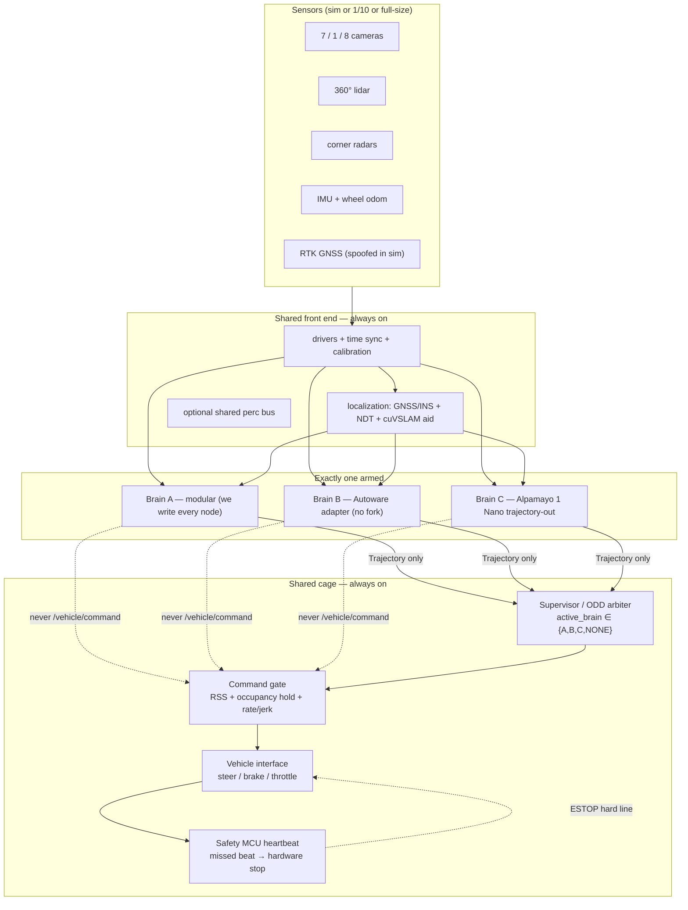
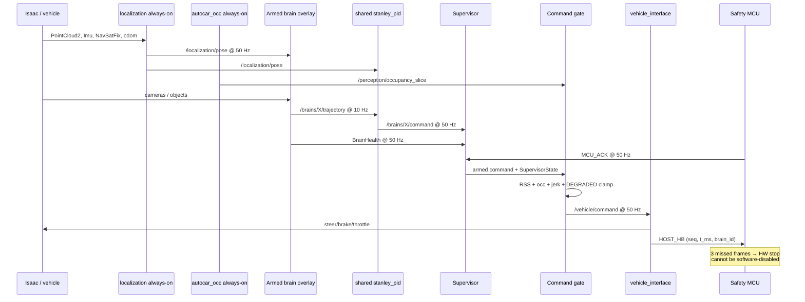
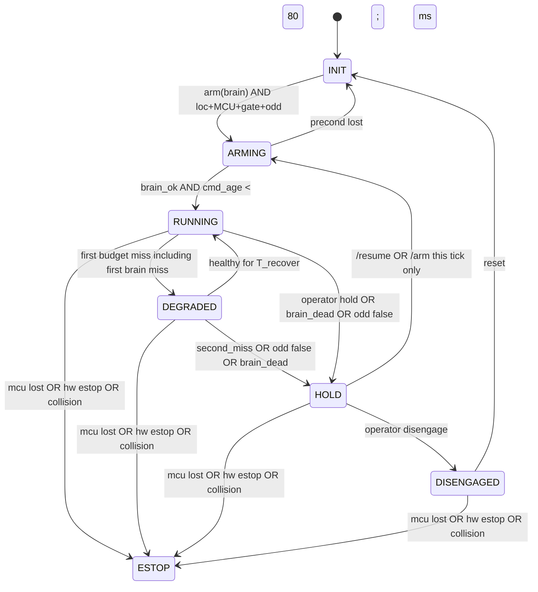
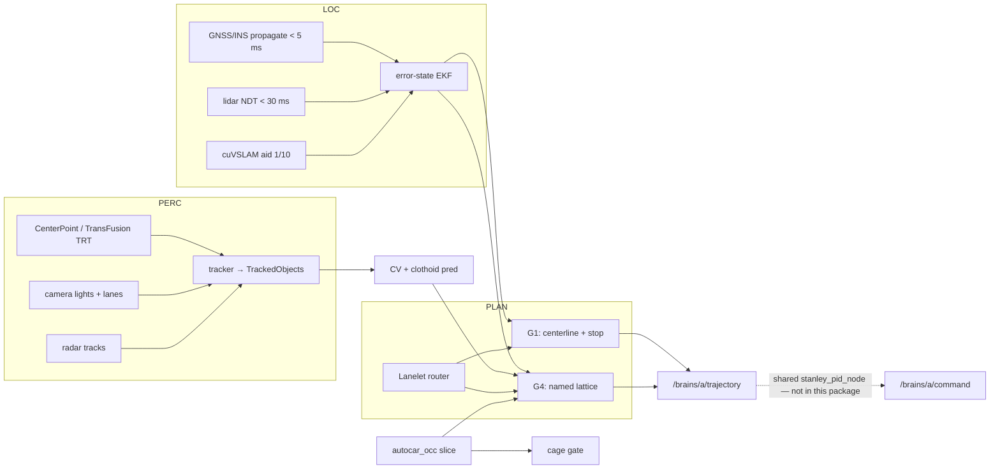

# Autonomous Car — System Design

| Field | Value |
| --- | --- |
| **Title** | Three Brains, One Cage: Research Stack Toward SAE L4 Inside a Written Geofence |
| **Author** | Aiman Hazim |
| **Date** | 2026-08-14 |
| **Status** | Draft |
| **Repo** | [`a-haz/autonomous-car`](https://github.com/a-haz/autonomous-car) · local `~/Code/autonomous-car` |
| **Audience** | Senior engineers implementing this repo from a green field |

This document is the implementation contract for a **new** public research stack. It is not a change to an existing AV product. There is no AV codebase yet. Do not write into thesis or PyroScout trees.

---

## Overview

We are building a research autonomous car that can be **compared, not conflated**: three autonomy brains — a from-scratch modular stack (A), an Autoware Core/Universe adapter (B), and NVIDIA Alpamayo 1 Nano (C) — drive **one** vehicle through **one** safety cage. Exactly one brain is armed. The cage (supervisor, RSS + occupancy command gate, rate/jerk limits, independent MCU heartbeat) is always on. Brain C cannot bypass the gate or the MCU.

This is a **research stack toward SAE L4 inside a written geofence**, not a claim that the car is L4. Never say “L4 car” without “research / driver until budget.”

The first vehicle is an **Isaac Sim 6.0.1 digital twin** (GUI-async on `max`) with the same ROS 2 topic names as hardware. Isaac 5.1.0 is parked on this 5070 Ti (`librtx.scenedb` crash — operational lab skill, not re-measured here). The first physical vehicle is a **1/10-scale F1TENTH-class Ackermann car** (Jetson Orin NX, 0–8 m/s, closed course). A full-size donor with a documented drive-by-wire kit is Phase 2, after SIL + 1/10 gates pass. Target ODD is a written geofence on campus / private roads, daylight, dry or light rain, 0–40 km/h. A safety driver remains until a written disengagement budget is met. Public-road Japan operation is out of scope without lab authorization.

This car is **not** the Tanaka-lab thesis. The thesis is TIR navigation on a mega rover in Isaac Sim. The car is RGB + lidar + radar, Lanelet2 roads, Ackermann, and a different repo.

---

## Background & Motivation

### Why this exists

Research AV work collapses in two ways: (1) a single opaque E2E policy that cannot be debugged or certified against a rule, or (2) a single classical stack that cannot absorb the new open VLAs. We want both, plus a third-party industrial baseline, behind a cage we own.

The comparison is only valid if A, B, and C see the same sensors, emit the same `Trajectory` / `VehicleCommand`, run the same scenario list, and die the same way when they lie.

### Current state

| Asset | What it is | What we take from it | What we do **not** do |
| --- | --- | --- | --- |
| [`~/Code/pyroscout`](https://github.com/a-haz/pyroscout) | From-scratch 2D thermal+lidar SAR stack | Layering: sense → log-odds map → inflated costmap → planner → geometric controller → **reactive safety brake** → FSM brain. Scenario + metric objects (`NavResult`, `StepRecord`). | Do not import the 2D unicycle, do not make this a search-and-rescue car, do not modify that repo. |
| `~/KENKYU` (Tanaka lab) | TIR nav / mega rover / Isaac Sim thesis | Machine notes only. **Operational skill** (`KENKYU/README/isaacsim-occlusion-capture/SKILL.md`): `max` Isaac **5.1.0 crashes** in `librtx.scenedb` on the 5070 Ti; **6.0.1 runs**. Headless `SimulationApp` segfaults on Blackwell. PC73 5090 32 GB is the thesis box (Isaac 5.1) and our overflow GPU, not the car’s primary SIL host. | This car is **not** the thesis. No IRA warehouse scene. No all-TIR requirement. No mega-rover chassis. Do not write into `KENKYU/` or `thesis-occlusion`. PR-03 rejects any import from `ira_warehouse_8` or `occlusion_v2`. |
| Machine `max` | RTX 5070 Ti 16 GB. Isaac 6.0.1 at `~/isaacsim` (**SIL lock**). Isaac 5.1.0 at `~/isaacsim-5.1.0` (**parked** on this GPU). | Nightly SIL host: `max` + 6.0.1 GUI-async. | Do not depend on headless `SimulationApp`. Do not assume 16 GB holds Isaac + Alpamayo 10B BF16. Do not treat PC73 as the car nightly (it is the thesis machine). |
| This repo | README + MIT + `docs/design.md` | Green field aside from this contract. | No Autoware fork, no DRIVE AV, no garage CAN hack. |

PyroScout's closed loop is the taste target for Brain A, lifted from 2D differential-drive to 3D Ackermann:

```
PyroScout:  lidar/thermal → OccupancyGrid.update → astar(costmap) → PurePursuit → DiffDriveRobot.step
            Navigator._apply_safety() is a last-inch brake
            scenarios.demo_navigator() + NavResult is the score

Brain A:    lidar/camera/(radar if present) → TrackedObjects + occ slice → Lanelet route
            → G1 centerline / G4 lattice → /brains/a/trajectory
            → shared stanley_pid_node → /brains/a/command
            cage command_gate + MCU is the last-inch brake (and cannot be deleted by a brain)
            scenarios/*.yaml + ScenarioScore is the score, shared with B and C
```

Cite, do not copy: `pyroscout/navigator.py` (`Navigator.step`, `_apply_safety`), `pyroscout/mapping/occupancy_grid.py` (inflate + clearance), `pyroscout/control/pure_pursuit.py`, `pyroscout/scenarios.py` (`demo_navigator` as the "one world, many tests" pattern).

### Pain points this design kills

1. **E2E that steers the rack.** A 10B VLA that writes steer/throttle is unverifiable. C emits a 6.4 s / 64-waypoint trajectory. The cage tracks it.
2. **Forked Autoware.** We will lose every upstream release. B is an adapter package only.
3. **Sim topics ≠ robot topics.** The digital twin uses the physical topic graph from day one.
4. **Thesis scene leakage.** IRA warehouse + NavMesh walkers are a rover problem. The car scene is a campus / private-road USD.
5. **“Try harder” on missed deadlines.** Miss a latency budget → degrade → stop. No adaptive “just this once.”

---

## Goals & Non-Goals

### Goals

1. Ship a **shared cage** (x86: Ubuntu 24.04 / Jazzy; 1/10 Orin: JP6.2 / Humble until JP7.2) with one `VehicleCommand` / `VehicleState` pair, supervisor, RSS + occupancy hold, rate/jerk limits, MCU heartbeat.
2. Implement **Brain A** ourselves: shared loc (GNSS/INS + lidar scan-match; cuVSLAM aid on 1/10), SIL CenterPoint/TransFusion TensorRT + camera/(radar if present), nvblox or lidar occ slice, CV/clothoid then learned prediction, Lanelet → G1 centerline / G4 lattice, shared Stanley + PID.
3. **Adapt** Autoware Core/Universe (B) and **Alpamayo 1 Nano** (C) to that cage. Exactly one of `{A, B, C, NONE}` is armed.
4. Score A, B, C on the **same scenario list** (cut-in, red light, lost loc, …) in SIL, then 1/10 Brain A. 1/10 B/C are not v0 (B is SIL-only until JP7.2; C is SIL-only until a surround kit).
5. Keep the repo public, MIT, author `aiman-hazim`, no AI commit trailers.

### Non-Goals

- SAE L4 on public Japanese roads, type approval, ISO 26262 / ASIL-D silicon, or a robotaxi fleet.
- Full-size donor body, EV powertrain design, or garage reverse-engineered CAN.
- Forking Autoware, DRIVE AV / Hyperion, DRIVE Sim, GR00T, Isaac Manipulator, cuMotion, Mission Dispatch, Alpamayo 2 Super 34B.
- Nav2 or Isaac for Mobility as the **car** planner.
- Camera-only as the only stack.
- Training on the vehicle. Brain C training is offboard → ONNX / official export.
- Collapsing this project into the TIR mega-rover thesis. Optional TIR is a later transfer experiment, not v0.
- Cosmos world-model data on the G4c critical path.

---

## Proposed Design

### Three brains, one cage



`SupervisorState.active_brain ∈ {A, B, C, NONE}`. Switching brains is allowed only from `HOLD` (then relaunch overlay). `DISENGAGED` must `/reset` → `INIT` before a new `/arm`. A running brain cannot hot-swap another brain into the rack.

**Gate HOLD ≠ supervisor HOLD.** Transient RSS / occupancy / stale-command braking keeps the supervisor in `RUNNING` or `DEGRADED`. Supervisor `HOLD` is an operator or health event (brain death, ODD exit, second budget miss).

### End-to-end data flow (one control tick)



`active_brain:=C` uses the **same** loc, occ, gate, MCU, and `/vehicle/command` path. C never publishes `/vehicle/command`.

### Supervisor state machine (single contract)

This table is the product. The mermaid and the Python in Reference Code §2 match it line-for-line. There is no second machine.

`T_recover = 1.0 s` (50 consecutive healthy ticks at 50 Hz).

`second_miss` owner: `autocar_watchdog`. Per `episode_id`, the first budget miss while `RUNNING` sets `Health.second_miss=false` and the supervisor enters `DEGRADED`. A second miss of **any** budget (loc / perc / brain / gate tick) in that same `episode_id` before a successful `DEGRADED→RUNNING` latch sets `Health.second_miss=true`. Clearing `second_miss` happens only on `episode_id++` (new arm) or `/supervisor/reset`.

Operator / launch actions (ROS 2 services, reliable):

| Service | Legal from | Effect |
| --- | --- | --- |
| `/supervisor/arm` `brain∈{A,B,C}` | `INIT`, `HOLD` | INIT: sets `_want` (step may enter ARMING). HOLD: sets `_want` **and** `_op=arm` this tick. **Not** legal from DISENGAGED (reset first). Ignored from RUNNING/DEGRADED/ESTOP/ARMING |
| `/supervisor/resume` | `HOLD` (same brain as current) | sets `_want=brain` and `_op=resume` → `HOLD → ARMING` |
| `/supervisor/hold` | `RUNNING`, `DEGRADED` | `→ HOLD`, `brain` remembered, **`_want` cleared**. Not legal from ARMING |
| `/supervisor/disengage` | `HOLD`, `RUNNING`, `DEGRADED` | `→ DISENGAGED`, `brain=NONE` |
| `/supervisor/reset` | `DISENGAGED` only | `→ INIT`, `episode_id++`, `_want=NONE` |
| hardware key / power cycle | `ESTOP` | MCU unlatch, then software comes up in `INIT`. **No ROS path out of ESTOP.** |



| From | To | Guard | Action |
| --- | --- | --- | --- |
| INIT | ARMING | `/supervisor/arm` AND `odd∧loc∧mcu∧gate` | `brain=_want` (not yet RUNNING) |
| INIT | INIT | precond false | stay; reason=`arm_precond` |
| ARMING | RUNNING | `brain_ok` AND `cmd_age_s < 0.080` | `episode` continues; reason=`armed_X` |
| ARMING | INIT | `¬(odd∧loc∧mcu∧gate)` | `brain=NONE` |
| RUNNING | DEGRADED | first watchdog miss (`¬(loc∧perc∧brain∧gate)`), including first `brain=false` tick | keep `brain`; gate enters degrade clamp |
| RUNNING | HOLD | operator `/hold` OR `odd=false` OR `brain_dead` (`brain` false for ≥ `BRAIN_DEATH_S` 0.300 s) | remember `brain`; **clear `_want`** |
| RUNNING | ESTOP | `¬mcu` OR `e_stop` OR `collision` | `brain=NONE`; command HOLD emergency |
| DEGRADED | RUNNING | healthy ticks ≥ `T_recover` / dt | clear degrade clamp |
| DEGRADED | HOLD | `second_miss` OR `odd=false` OR `brain_dead` | remember `brain`; **clear `_want`** |
| DEGRADED | ESTOP | `¬mcu` OR `e_stop` OR `collision` | `brain=NONE` |
| HOLD | ARMING | **this tick** `_op∈{resume,arm}` (not a leftover `_want`) | if other brain: **relaunch overlay** then ARMING |
| HOLD | DISENGAGED | `/disengage` | `brain=NONE` |
| HOLD | ESTOP | `¬mcu` OR `e_stop` OR `collision` | `brain=NONE` |
| DISENGAGED | INIT | `/reset` | `episode_id++` |
| DISENGAGED | ESTOP | `¬mcu` OR `e_stop` OR `collision` | `brain=NONE` (already NONE) |
| ESTOP | ESTOP | always | **no software exit** |

**DEGRADED actuator (gate owns it).** Supervisor only flips the enum. The command gate, on `state==DEGRADED`, rewrites longitudinal so `v` is driven toward `v_degrade` (4.0 m/s sim, 1.5 m/s 1/10) using `accel = -a_hold` while `v > v_degrade`, else `accel = 0`, **holds last steer**, sets `GateStatus.reason=degraded`. RSS/occ may still escalate to emergency HOLD.

**PR-02 tests (do not invent a one-tick stop; jerk clip is real):**
1. DEGRADED command-shape, **one 20 ms tick**, `v0 = 11 m/s`, `_last.accel` typically 0: `steer == last`, **desired** accel is `−a_hold`, **published** accel has moved toward `−a_hold` by at most `j_max*dt` (0.10 m/s²; from 0 that is `−0.10`, not `−3.0`), `reason == "degraded"`, verdict is `clip` unless `_last.accel` was already `−a_hold`. Not RSS/occ HOLD. Do **not** assert published `accel == -a_hold` or `v ≤ v_degrade` on this tick.
2. DEGRADED settle, bicycle fixture: `v ≤ v_degrade` only after **`n = ceil((v0-v_degrade)/(a_hold*dt))` ticks** (11→4 at 3.0 m/s² and 50 Hz: **`ceil(7/0.06) = 117` ticks = 2.34 s**). Do not write `range(3)`. Equivalent phrasing: “run 3.0 s at 50 Hz (150 ticks) and then assert.”
3. **HOLD persistence:** RUNNING → `/hold` → step 50 ticks (1.0 s) with the original arm `_want` still conceptually in memory **but `_want` cleared on HOLD entry**; assert `state == HOLD` every tick. Then `/resume` → ARMING. Leftover `_want` from INIT/ARMING must not auto-resume.

**Collision detector (ESTOP):** `/vehicle/state.collision` is true if (a) SIL: PhysX contact on the chassis prim, or (b) metal: any `OccupancySlice` cell inside the chassis footprint (`base_link` rectangle `L×track` inflated 0), or (c) IMU spike `|a| > 8 m/s²` for 2 samples — (c) is advisory DEGRADED until G5 measures false-positive rate; (a)(b) are ESTOP.

---

## Shared Cage (always on)

### Platform (split: x86 SIL vs Orin NX)

Compatibility layer across machines is **IDL + frozen topic names**, not one OS/Isaac-ROS matrix.

| Item | `max` SIL (x86) | 1/10 Orin NX |
| --- | --- | --- |
| OS | Ubuntu 24.04 LTS | JetPack **6.2** / Ubuntu 22.04 **unless/until** JP7.2 Orin is GA |
| ROS 2 | **Jazzy** | **Humble** |
| Isaac ROS | **4.x** + NITROS | **3.2** (public matrix). Do not buy the Orin assuming 4.x debs install. |
| RMW | Host cage: `rmw_cyclonedds_cpp`. Isaac ROS / NITROS nodes stay in the NVIDIA container with **that image’s** RMW. Boundary is CPU `PointCloud2` / `Image` or NITROS-bridge. | Same split: Humble Cyclone on cage nodes; Isaac ROS 3.2 container RMW inside. |
| Sim | Isaac Sim **6.0.1** (`~/isaacsim`), GUI-async | n/a |
| Isaac 5.1.0 | **Parked** on this 5070 Ti (`librtx.scenedb` crash per operational skill). Not the SIL lock. | n/a |
| Sim launch | **GUI-async only** (`next_update_async`). Headless `SimulationApp` segfaults on Blackwell. | n/a |
| Maps | Lanelet2 + NDT PCD | Same files, copied |
| Vehicle model | Bicycle, Ackermann | Same params, measured `L` |
| Logs | MCAP + Foxglove + `/clock` | MCAP lite |

Env vars in `autocar_bringup/launch/vehicle.launch.py`:

```
RMW_IMPLEMENTATION=rmw_cyclonedds_cpp          # host cage
# Isaac ROS container: do not override; use image default
CYCLONEDDS_URI=file://$(find autocar_bringup)/cyclone_localhost.xml
```

### Topic graph (frozen names)

These names are the same in Isaac, 1/10, and (later) full-size. Brains do not invent aliases.

| Topic | Type | Rate | QoS |
| --- | --- | --- | --- |
| `/sensors/lidar/points` | `sensor_msgs/PointCloud2` | 10 Hz | best effort, keep last 1 |
| `/sensors/camera/<name>/image` | `sensor_msgs/Image` or `CompressedImage` | 10–20 Hz | best effort |
| `/sensors/camera/<name>/camera_info` | `sensor_msgs/CameraInfo` | latched | reliable |
| `/sensors/radar/<fl,fr,rl,rr>/detections` | `autocar_msgs/RadarDetections` | 20 Hz | best effort |
| `/sensors/imu` | `sensor_msgs/Imu` | 100–200 Hz | best effort |
| `/sensors/gnss` | `sensor_msgs/NavSatFix` | 10 Hz | best effort |
| `/vehicle/wheel_odom` | `nav_msgs/Odometry` | 50 Hz | reliable |
| `/localization/pose` | `geometry_msgs/PoseWithCovarianceStamped` | 50 Hz | reliable |
| `/localization/odom` | `nav_msgs/Odometry` | 50 Hz | reliable |
| `/perception/tracked_objects` | `autocar_msgs/TrackedObjects` | 10 Hz | reliable |
| `/map/lanelet` | `autocar_msgs/LaneletMapMeta` + file | latched | reliable |
| `/brains/{a,b,c}/trajectory` | `autocar_msgs/Trajectory` | 10 Hz | reliable |
| `/perception/occupancy_slice` | `autocar_msgs/OccupancySlice` | 10 Hz | reliable |
| `/perception/predicted_objects` | `autocar_msgs/PredictedObjects` | 10 Hz | reliable |
| `/map/lights` | `autocar_msgs/TrafficLightStates` | 10 Hz | reliable |
| `/brains/{a,b,c}/command` | `autocar_msgs/VehicleCommand` | **50 Hz** (min 25 Hz before stale) | reliable |
| `/brains/{a,b,c}/health` | `autocar_msgs/BrainHealth` | 50 Hz | reliable |
| `/supervisor/state` | `autocar_msgs/SupervisorState` | 50 Hz | reliable |
| `/gate/status` | `autocar_msgs/GateStatus` | **50 Hz** | reliable |
| `/vehicle/command` | `autocar_msgs/VehicleCommand` | 50 Hz | reliable, **after gate** |
| `/vehicle/state` | `autocar_msgs/VehicleState` | 50 Hz | reliable |
| `/mcu/tx` `/mcu/rx` | `autocar_msgs/McuFrame` | 50 Hz | reliable |
| `/clock` | `rosgraph_msgs/Clock` | sim | — |
| `/tf` `/tf_static` | TF2 | — | — |

Camera `<name>` set (Phase 0 SIL): `long` (tele 30°), `wide` (120°), `rear`, `sl`, `sr`, `rl`, `rr`. Alpamayo 1 v0 consumes **four**: `wide`→front-wide, `long`→front-tele, `sl`→cross-left, `sr`→cross-right. Phase 1 publishes `wide` (D455 RGB) + `stereo/{left,right,depth}` only. A brain that requires a missing camera must fail health, not silently run. **Brain C is SIL-only until a surround kit** (see sensor-ODD matrix).

Injector / light topics (frozen):

| Topic / service | Type | Owner |
| --- | --- | --- |
| `/scenario/inject/cut_in` | `autocar_msgs/srv/InjectCutIn` | scenario runner |
| `/scenario/inject/red_light` | `autocar_msgs/srv/InjectRedLight` | scenario runner |
| `/scenario/inject/loc_drop` | `autocar_msgs/srv/InjectLocDrop` | scenario runner |
| `/map/lights` | `autocar_msgs/TrafficLightStates` | detector **or** injector; planner binds by Lanelet id |

### Frames

- `earth` / UTM zone of the map (map origin in Lanelet header)
- `map` — NDT / Lanelet origin
- `odom` — integrated (wheel + IMU), may drift
- `base_link` — rear-axle center, ISO 8855 (+x forward, +y left, +z up)
- `gnss_link`, `imu_link`, `lidar_link`, `camera_<name>_link`, `radar_<id>_link`

Static TF from a single `calibration/extrinsics.yaml`. No node hard-codes a lever arm.

### One vehicle contract

`VehicleCommand` is the only thing that may move the car. It is Ackermann: `steering_tire_angle_rad`, `accel_mps2` (negative = brake), `gear`, `blinker`, plus a `hold` flag. There is no steer-torque path in v0. There is no PWM path except inside `vehicle_interface` (VESC) or the Phase 2 DBW SDK.

`VehicleState` is the only kinematics the brains are allowed to treat as truth for control: pose in `map` is **not** inside `VehicleState`; pose comes from `/localization/*`. `VehicleState` is body: `v`, `yaw_rate`, `steer`, `accel`, gear, `estop_latched`, `rc_override`, `mcu_ok`, `collision`.

### Command gate (always between brain and rack)

Every tick at a **frozen 50 Hz** (budget **< 50 ms** end-to-end including RSS). Brains must publish commands at 50 Hz. Stale threshold is 80 ms = two missed ticks → HOLD. That is intended, not a hair-trigger at a 20 Hz minimum (the 20 Hz floor is **deleted**).

1. Drop commands whose `header.stamp` is older than 80 ms (sim: `/clock`).
2. If supervisor is `ESTOP`/`INIT`/`ARMING`/`HOLD`/`DISENGAGED`: emit **HOLD** at `accel = -a_hold` (comfort), steer held. If supervisor is `ESTOP` or `collision`: HOLD at `-a_min_brake_rear` (emergency).
3. If supervisor is `DEGRADED`: **degrade clamp** (owner = gate). Target `v → v_degrade`, last steer held, `reason=degraded`. Then still run RSS/occ; those may escalate to emergency HOLD.
4. **Lead selector:** closest `TrackedObject` with `classification ∈ {CAR, TRUCK, PED, CYCLIST}` whose footprint intersects a 1.5 s corridor of width `track + 2 r_inflate` along current heading. If none, RSS is a no-op.
5. **RSS Rule 1** vs that lead, using **separate** `a_min_brake_rear` (what we guarantee) and `a_max_brake_front` (worst-case lead slam). See `rss_dmin`.
6. **Occupancy collision hold:** `OccupancySlice` cells are **already** inflated by `r_inflate + track/2` in `autocar_occ`. Gate tests point-in-envelope with epsilon `0.05 m` — do **not** inflate again.
7. **Rate / jerk clamp**, then **re-evaluate RSS** on the clipped command. If the clipped command still violates RSS, HOLD emergency.
8. Publish `/vehicle/command` and `/gate/status` (`pass` | `clip` | `hold`, reason enum). These strings are the ABI.

Missed gate tick → HOLD comfort. The gate does not “try harder.”

v0 numbers (full-size twin and 1/10 share the *symbols*; values are param-file):

| Symbol | Sim / campus twin | 1/10 |
| --- | --- | --- |
| `a_min_brake_rear` (RSS, us) | 6.0 m/s² | 4.0 m/s² |
| `a_max_brake_front` (RSS, lead worst-case) | 8.0 m/s² | 6.0 m/s² |
| `a_max_accel` | 2.5 m/s² | 3.0 m/s² |
| `a_hold` (comfort / stale / supervisor not running) | **3.0 m/s²** | **3.0 m/s²** |
| `ρ` response time | 0.40 s | 0.25 s |
| `δ̇_max` | 0.50 rad/s | 1.20 rad/s |
| `j_max` | 5.0 m/s³ | 8.0 m/s³ |
| `r_inflate` | 0.30 m | 0.08 m |
| corridor inflate | `r_inflate + track/2` | same rule |
| envelope horizon | 1.5 s | 1.0 s |
| `v_degrade` | 4.0 m/s | 1.5 m/s |
| `v_max` ODD | 11.11 m/s (40 km/h) | 8.0 m/s |

RSS v0 is **Rule 1 only**. We do **not** claim Rule 2–5. Lateral threats become leads only if they enter the corridor above. Behavior-tree yield is not an RSS proof.

### MCU heartbeat (cannot be software-disabled)

A separate MCU (STM32G4 class) has a **hardware** path to the brake / VESC inhibit / DBW disable. The host cannot clear that path from Linux.

- Link: UART 115200 8N1 (Phase 0 loopback + Phase 1), CAN 500 kbit/s optional dual (Phase 2).
- Host → MCU `HOST_HB` at 50 Hz. MCU → host `MCU_ACK` at 50 Hz.
- **3 consecutive missed host frames (60 ms) → hardware stop.** Latch until power cycle or a keyed hardware reset.
- Cabin / bumper e-stop is wired in series with the MCU inhibit. ROS cannot mask it.

Frame layout is in [Reference code — MCU](#7-mcu-heartbeat-protocol).

### Time sync

| Phase | Clock |
| --- | --- |
| 0 SIL | `use_sim_time:=true`, `/clock` from Isaac. All nodes must honor it. |
| 1 1/10 | Chrony to a phone-hotspot or local GPS PPS if present. Host stamps in `time.now()`. MCU carries its own `t_ms` from start; host estimates offset. |
| 2 | Hardware PTP / GMSL2 frame sync. Holoscan Sensor Bridge is **Phase 2 later**, not v0. |

### Maps

- **Lanelet2** OSM-like XML: lanes, regulatory elements, speed, lights. One map package per site: `maps/campus_v0/`, `maps/lot_v0/`, `maps/figure8_v0/`.
- **NDT target**: voxelized PCD, 0.2 m, stored next to the Lanelet file. Localization is NDT-OMP against this cloud (CPU v0; GPU NDT if we need the 30 ms budget).
- **`autocar_occ`** (always on) publishes `/perception/occupancy_slice`. G0–G2: lidar 2D projection / hit-scan in `map`, voxel 0.10 m. G3+: nvblox 2D slice at bumper height **0.40 m** (twin) / **0.08 m** (1/10). Cells are inflated **once** by `r_inflate + track/2` before publish. The **gate node** calls `slice_to_xy()` (occupied cells → map-frame centroids) then `occupancy_hit`. nvblox is local TSDF; it is not the HD map and must not invent lane centerlines.

### Logging & replay

- Default recorder: `ros2 bag record` MCAP, profile `autocar_all` (sensors + loc + brains + gate + supervisor) and `autocar_lite` (no raw cameras).
- Replay: `ros2 bag play --clock` with `use_sim_time:=true`. Scenario SIL can also inject from YAML without a bag.
- **Storage estimate** (Phase 0, 7× 1280×720 H.264 ~6 Mbit/s each + OS1-64-class lidar):

  | Stream | Rate | 10 min |
  | --- | --- | --- |
  | 7 cameras compressed | ~5 MB/s | ~3.0 GB |
  | OS1-64-class lidar (dual return, Foxglove-compressed) | ~8 MB/s | ~4.8 GB |
  | 4 radars + IMU + GNSS + TF + commands | ~0.4 MB/s | ~0.24 GB |
  | **Total `autocar_all`** | **~13–15 MB/s** | **~8–9 GB / 10 min** |
  | `autocar_lite` (no cameras) | ~8.5 MB/s | ~5 GB / 10 min |

  Disk policy: 2 TB NVMe on `max` keeps ~35 hours lite / ~20 hours all. Rotate at 80% with a Foxglove-visible warning. **Do not commit bags.**

---

## Brain A — From-scratch modular (primary research stack)

We write every node. PyroScout layering in 3D, Ackermann, HD map.



### Localization (shared front end — not Brain-A-only)

`autocar_loc` is **always launched**. A, B, and C consume `/localization/pose`. Autoware’s own NDT is **disabled**; we force `/localization/pose` into Autoware as external pose.

**v0 EKF state (locked):** `[x, y, θ, v, b_az]` in `map`.

| State | Propagate | Update |
| --- | --- | --- |
| `x,y,θ` | bicycle + wheel odom + yaw-rate (`r - b_az`) | NDT-OMP (10 Hz), GNSS when `gnss_ok` |
| `v` | accel integrate | wheel odom speed |
| `b_az` | random-walk | NDT / GNSS heading innovation |

- **Propagate:** 50 Hz, budget **< 5 ms**.
- **Update:** lidar scan-match via **`ndt_omp`** (Takeda `atsushi_takeda/ndt_omp` ROS 2 port, or Autoware’s `autoware_ndt_scan_matcher` used as a library — pin in `autocar_loc/NDT_PIN.md`). Voxel **0.2 m**. Budget **< 30 ms**.
- **G2 map:** record one open-loop figure-8 bag (PR-03a bicycle or PR-03b Isaac), run offline NDT mapper, check in `maps/figure8_v0/ndt.pcd`.
- **cuVSLAM (Isaac ROS):** **aid on 1/10 only**, relative `Δpose` factor on `[x,y,θ]` with the vendor covariance. It does **not** replace NDT or GNSS. If cuVSLAM dies, loc stays up. On Orin this is Isaac ROS **3.2**, not 4.x.
- Output: `/localization/pose` with 6×6 covariance (unused axes large). Loc unhealthy when **`sqrt(P_xx + P_yy) > 0.8 m` (sim) or `> 0.4 m` (1/10 lot)** for > 1.0 s → supervisor DEGRADED. The 0.4 m 1/10 bar is loosened until measured; 0.15 m is not v0.

### Perception

- SIL lidar 3D detect: **CenterPoint-tiny** TensorRT on OS1-64-class clouds (nuScenes-domain). 10 Hz, budget **< 70 ms** including track.
- 1/10 lidar detect: **PointPillars-Livox** (or a Mid-360 fine-tune). CenterPoint-nuScenes is **not** expected to transfer to a non-repetitive Mid-360. Domain-adapt is a G5 follow-up, not “CenterPoint still means something.”
- Camera: traffic-light classifier + lane model. Detector output may include `CLASS_TRAFFIC_LIGHT` on `/perception/tracked_objects` **as a raw detection only**. The planner / G4 injector binds lights to **Lanelet TrafficLight regulatory elements** via `/map/lights` (`lanelet_id → state`). Never plan on “nearest bulb.”
- Radar: SIL and Phase 2 only. **1/10 radar = none**; tracker is lidar+camera.
- Tracker: AB3DMOT-style, output `TrackedObjects`.
- **Isaac ROS DNN / stereo / occupancy (NITROS)** on x86 4.x / Orin 3.2 where it beats a from-scratch port.
- `perc_source:=gt|trt` launch param. G1 uses `autocar_perc_gt`. G3+ uses `trt`. The planner does not know which one is running.

### Costmap

- Always-on `autocar_occ` as above. Analog of PyroScout `OccupancyGrid.costmap(inflate_radius=...)`.
- HD map occupancy (Lanelet bounds + static PCD) is a second layer inside the same `OccupancySlice` (`source` field). Neither replaces Lanelet routing.

### Prediction

- v0: constant-velocity + clothoid for turners, **64 × 0.1 s** per track (`PredictedObjects`). Same horizon as Alpamayo.
- v1: learned predictor, same message.

### Planning

**Do not call the G1 centerline planner a lattice.**

- Global: Lanelet2 route from current lanelet to goal. No free-space A* as the road planner.
- **G1 (locked):** centerline resample to 64×0.1 s + stop-if-red (Lanelet-bound light) + stop-if-static-in-corridor (`half_w = track/2 + r_inflate`). Nearby moving actors do **not** zero `v` — that is the gate’s RSS job (`cut_in` must be allowed to HOLD without the planner slamming 0).
- **G4 (locked named lattice):** Frenet samples `N_lat ∈ {−2,−1,0,1,2} × 0.4 m`, `N_v ∈ {0, v/2, v_cruise}`, each rolled 64×0.1 s with the bicycle. Cost = `−progress_m + 10·collision + 2·|lat_m|`. Collision vs `OccupancySlice` + `PredictedObjects`. First feasible min-cost sample wins; if none, publish a stop trajectory and `BrainHealth.degraded`.
- Behavior tree: **py_trees** (Python, G4+). Leaves: `FollowLane`, `StopAtLine`, `HoldForLight`, `FollowLead`. `AvoidStatic` is the lattice. `Degrade`/`Park` wait until G5. No BehaviorTree.CPP in v0.
- Output: `autocar_msgs/Trajectory` — **64 poses, 0.1 s, 6.4 s**. Shared contract with Brain C.

### Control

- v0 **locked**: **one** shared `stanley_pid_node` (package `autocar_ctrl`). Brain A plan publishes **trajectory only**; it does **not** run a second Stanley. Remap: subscribe `/brains/{active}/trajectory` → publish `/brains/{active}/command`.
  - Stanley: `δ = θ_e + arctan(k e / (v + v_eps))`, clamp `δ_max`.
  - Long: PID on `v_ref`, saturate to comfort; gate may still apply `a_hold` or `a_min_brake_rear`.
- MPC lat/long is a **G4 escape hatch** (not G1): only if figure-8 cross-track > 0.35 m sim / 0.08 m 1/10 after Stanley tune. G1 may use a looser 0.50 m catalog bar.
- Node budget: **50 Hz, < 20 ms**.

Bicycle:

```
x' = v cos θ
y' = v sin θ
θ' = v tan(δ) / L
```

`L = 2.70 m` (twin). 1/10 `L` is a **measured** param (Slash 4×4 stock wheelbase is ~0.335 m; PR-12 writes the tape value into `vehicle_interface` params). Exact-arc integration, same idea as `DiffDriveRobot.step` in PyroScout — no Euler on the yaw.

### What Brain A does *not* do

- It does not talk to VESC or DBW. It publishes **`/brains/a/trajectory` only**. The shared `stanley_pid_node` writes `/brains/a/command`.
- It does not run a second Stanley or PID.
- It does not disable the MCU.
- It does not train.

---

## Brain B — Autoware Core/Universe adapter

**Adapter only. Do not fork Autoware.** Consume Autoware as a workspace overlay.

**Pin (locked policy):** `brains/autoware_adapter/AUTOWARE_PIN.md` records the first `autowarefoundation/autoware` meta-repo SHA that `colcon build`s **Core + Universe on Ubuntu 24.04 / Jazzy**. Until that SHA is written (PR-09b), adapter unit tests mock `autoware_planning_msgs`. G4b CI: **45 min timeout**, restore cache artifact `autoware-jazzy.tar`; on cache miss **fail** (or rebuild once), do **not** skip. Target line: Autoware Core 1.5.x + Universe 0.48.x Jazzy (TSC 2025-11 stated those as the next releases); the SHA in the pin file is the contract, not this sentence.

**Brain B runtime is Jazzy/x86 SIL only until JP7.2 Orin Universe exists.** The Jazzy SHA is not a Humble overlay. PR-13 does **not** run Autoware Universe on the Orin. IDL+topics still let the *adapter* compile on Humble for unit tests.

### Role

1. Industrial baseline on the **same** map conventions (Lanelet2, `base_link`, ISO 8855).
2. Future full-size bring-up path: Autoware already speaks Dataspeed-class vehicles; our adapter keeps our cage.
3. A second teacher for Brain C (trajectories, not images).

### Who owns loc / perc / control

- **Our** `autocar_loc` is the pose. Disable Autoware NDT / EKF. Remap Autoware’s input pose to `/localization/pose`.
- Autoware may run its own perception **inside B** for its planner; G4b comparison still scores on **our** `/perception/tracked_objects` when the catalog injector fires. Preferred v0: feed Autoware detected-objects from our bus (remap table).
- **Our** shared Stanley is the controller (`adapter.mode:=traj`).

### Remap table (v0)

| Autoware name | Ours |
| --- | --- |
| `/sensing/lidar/top/pointcloud_raw` | `/sensors/lidar/points` |
| `/sensing/imu/tamagawa/imu_raw` | `/sensors/imu` |
| `/sensing/gnss/pose_with_covariance` | `/sensors/gnss` + loc converter |
| `/localization/kinematic_state` (in) | `/localization/odom` |
| `/localization/pose_with_covariance` (in) | `/localization/pose` |
| `/map/vector_map` | `maps/<site>/lanelet2.osm` via `autoware_map_loader` |
| `/planning/scenario_planning/trajectory` | adapter in |
| `/control/command/control_cmd` | adapter `mode:=control` only |
| `/vehicle/status/*` | `/vehicle/state` converter |

No AWSIM. Autoware planning ticks on our Isaac `/clock` and our vehicle interface. We do **not** start Autoware `vehicle_cmd_gate` onto `/vehicle/command`.

### Boundary

```
Autoware planning → autoware_planning_msgs/Trajectory
                 → autocar_autoware_adapter
                 → autocar_msgs/Trajectory  (resampled 64 × 0.1 s)
                 → shared Stanley/PID
                 → /brains/b/command
```

`adapter.mode:=traj` (default) ignores Autoware `Control.longitudinal.velocity` except as `speed_ref_mps` advisory. `mode:=control` maps `lateral.steering_tire_angle` → steer and `longitudinal.acceleration` → accel; **velocity is not a rack command** in v0 (our interface is accel+steer).

Autoware `TrajectoryPoint` (upstream, do not modify):

```
builtin_interfaces/Duration time_from_start
geometry_msgs/Pose pose
float32 longitudinal_velocity_mps
float32 lateral_velocity_mps
float32 acceleration_mps2
float32 heading_rate_rps
float32 front_wheel_angle_rad
float32 rear_wheel_angle_rad
```

Resample onto a 0.1 s grid, trim/pad to 64 points, convert `map` → ego using `/localization/pose`. If Autoware publishes fewer than 2 s of path, mark `BrainHealth.degraded` and let the supervisor decide.

### What we do not do

- No patches under `autoware/` in this repo.
- No Autoware `vehicle_cmd_gate` as a replacement for **our** gate. Autoware's gate may run *inside* B for its own nodes; the car still only moves on `/vehicle/command` from **our** gate.
- No AWSIM / DRIVE Sim requirement. B in v0 is replay + Isaac via our vehicle interface.

---

## Brain C — Alpamayo 1 Nano

Default policy: **NVIDIA Alpamayo 1 Nano** (open 10B reasoning VLA), trajectory-out.

- Inference code (maintenance mode): <https://github.com/NVlabs/alpamayo>. **Active hub:** <https://github.com/NVlabs/alpamayo-recipes> (SFT/RL) and Alpamayo 1.5.
- Weights: `nvidia/Alpamayo-R1-10B` (OpenMDW-1.1). Inference code Apache-2.0.
- Paper: Alpamayo-R1, arXiv:2511.00088.
- **C v0 I/O is Alpamayo 1**, not 1.5: **4 cameras** (`wide`, `long`, `sl`, `sr`) + **16 ego-history waypoints @ 10 Hz** (pose + rotation) in → **6.4 s / 64 waypoints @ 10 Hz** `(x,y,z,R_rot)` in ego + CoC string. Trajectory-out, **not** steer-out.
- Alpamayo 1 / R1-10B does **not** take route/nav tokens and does **not** emit meta-actions.
- Alpamayo **1.5 does take navigation guidance**. It is **not** a drop-in. If we swap 1.5, add optional `nav_text` on `Trajectory` (or a sibling message) and do **not** claim “no route tokens.”
- **Alpamayo 2 Super 34B is out of scope.**
- **Cosmos is later, not on the G4c critical path.**

### Runtime — 16 GB configs (locked; no leftover-arithmetic)

NVIDIA README: **≥ 24 GB VRAM**; 16 GB “will likely result in CUDA OOM.” BF16 10B ~**21.5 GB** allocated; weights download ~22 GB.

| Box | GPU | VRAM | What runs |
| --- | --- | --- | --- |
| `max` (nightly SIL) | RTX 5070 Ti | **16 GB** | Isaac **6.0.1** + Brain A + occ. **Not** BF16 10B. |
| PC73 (overflow / teacher) | RTX 5090 | 32 GB | Official 10B / AlpaSim. Thesis machine — schedule around that. |
| 1/10 car | Orin NX 16 GB | 16 GB shared | C is **not on the car in v0** |
| 1/10 later | Orin or Thor | — | 3-cam student or Thor 10B — not G5 |

**Exactly two supported `max` configs.** There is no “12 GB engine + 4 GB leftover for live Isaac.”

| ID | Allowed |
| --- | --- |
| **M1** | Live Isaac 6.0.1 + A + loc + occ. C = **stub only** (no student weights on the live GPU). |
| **M2** | Isaac paused **or** cameras replayed from a bag + student/FP8 on the 5070 Ti. Official 10B still forbidden here. |

If a 16 GB FP8 engine appears, require a **measured** `nvidia-smi` on `max` before reopening M1+C-live. Do not reopen on a target.

**v0 inference plan:**

1. **G4c CI / contract:** `AlpamayoStubPolicy` — no GPU. PRs run this.
2. **Official 10B:** `autocar_e2e/offboard_infer` on PC73 over **localhost or 10 GbE lab LAN only**. Budget **150 ms is a lab-LAN number**, not Wi-Fi. Wi-Fi or timeout → brain death → supervisor HOLD. mTLS if the infer box is not `max` itself.
3. **1/10:** C is **SIL-only until a surround kit**. A 3-cam D455+globals student is a later epic, not G5.
4. **Train path:** Isaac Lab / our SIL is the **data factory** (A/B teacher trajectories + camera bags). **Alpamayo Recipes SFT/RL** is how the 10B (or student) is trained. Isaac Lab is **not** a 10B VLA trainer.
5. Distill 10B → 1–2B is an **epic (PR-11\*)**, cannot block G5.
6. Eval: AlpaSim *plus* our catalog through the **same gate**.

Paper ~99 ms is **NVIDIA’s optimized on-vehicle number**, not this stack. **v0 gate for C:** stub is realtime; offboard is “whatever PC73 measures”; hold last 64-point spline **300 ms** then brain death. 100 ms infer + 20 ms adapter is a **goal copied from the paper**, not a v0 pass/fail.

### Adapter

`autocar_alpamayo_adapter`:

- Subscribe `wide`, `long`, `sl`, `sr` (Alpamayo 1 four-cam). Missing cam → black frame + `BrainHealth.degraded`.
- Keep a **16-sample ego-history buffer** of `(x, y, yaw)` @ 10 Hz. Convert to 3×3 `R_rot` with `yaw_to_R` at the official-loader boundary. Do not take `R_rot` as a second adapter ABI.
- Call stub / student / offboard.
- Convert `(x,y,z,R_rot)` → our `TrajectoryPoint`: `yaw = atan2(R_10, R_00)`; `v`, `a`, `kappa` by **finite difference** on the 64 ego waypoints (`v_k = ||p_{k+1}-p_k||/Δt`, `a_k = (v_{k+1}-v_k)/Δt`, `kappa_k = Δyaw/||Δp||`). Last point copies previous `v/a/kappa`.
- Publish `/brains/c/trajectory` (64 pts, `reasoning` = CoC). Shared `stanley_pid_node` writes `/brains/c/command`.
- Never publish `/vehicle/command`. Do not run Stanley inside the adapter.

---

## NVIDIA adopt / adapt / later / skip

| Decision | Product | How we use it |
| --- | --- | --- |
| **Adopt** | Isaac Sim **6.0.1** on `max` (5.1 parked on this 5070 Ti) | Digital twin, GUI-async, same topics as metal |
| **Adopt** | Isaac ROS 4.x + NITROS **on x86** (Sim 6.0 **best-effort**; fallback CPU clouds); Isaac ROS 3.2 **on Orin NX** | 4.x matrix lists Sim 5.1 |
| **Adopt** | nvblox | Local TSDF / occupancy slice via `autocar_occ`; does not replace Lanelet |
| **Adopt** | cuVSLAM | 1/10 vision/IMU **aid**, fused, not substituted (Humble/3.2 on Orin) |
| **Adopt** | Isaac Lab | **Data factory** (A/B teacher traj + cameras). Not the 10B trainer. |
| **Adopt** | Alpamayo Recipes | Official SFT/RL for C |
| **Adopt** | Alpamayo 1 Nano + AlpaSim | Trajectory-out VLA + their closed-loop eval |
| **Adapt** | Isaac for Mobility | Occupancy helpers only. **Not** Nav2-as-car-planner |
| **Adapt** | Nova Carter launch / graphs | Camera/NITROS launch *patterns*. **Not** the diff-drive chassis |
| **Later** | Cosmos | World-model data. Not on G4c critical path |
| **Later** | Holoscan Sensor Bridge | Phase 2 GMSL2 bring-up |
| **Skip** | DRIVE AV / Hyperion | Closed OEM stack |
| **Skip** | DRIVE Sim | We have Isaac |
| **Skip** | GR00T | Humanoid |
| **Skip** | Isaac Manipulator | Arms |
| **Skip** | cuMotion | Manipulator motion |
| **Skip** | Mission Dispatch | Fleet AMR |
| **Skip** | Alpamayo 2 Super 34B | Out of scope / VRAM |

---

## Hardware Phases

### Phase 0 — Isaac Sim digital twin (now)

Ackermann vehicle USD, **same topic names** as physical.

| Sensor | Spec |
| --- | --- |
| Cameras | 7: `long` 30° FOV, `wide` 120°, surround `sl/sr/rl/rr`, `rear`. 1280×720, 10–20 Hz, JPEG/H.264 to ROS |
| Lidar | Roof 360°, **OS1-64 class**: 64 beams, ~45° VFOV, 10 Hz, ≥120 m, dual return. Isaac RTX lidar configured to this, not VLP-16-as-rover |
| Radar | 4 corner **or** 1 long + 1 rear + 2 corner. Ideal detections + noise model |
| IMU | 100–200 Hz, bias + noise |
| Wheel odom | From PhysX joints, 50 Hz |
| GNSS | Spoofed RTK from GT pose + cm-level noise; dropouts injectable |
| TIR | **Optional, off by default.** Thesis-transfer experiment only. Not required for G0–G5 |

Scene: **campus / private-road USD** with Lanelet overlay. **Not** the IRA warehouse walker scene (`KENKYU/B4/latest-isaac-files/ira_warehouse_8/`). Figure-8 and a parking-lot subset ship first.

Launch constraint: Kit / Script Editor / `next_update_async` on **Isaac 6.0.1**. **No headless `SimulationApp`.** PR-03 code review rejects any import from `ira_warehouse_8` or `occlusion_v2`.

Twin vehicle params: `L=2.70 m`, mass 1 500 kg (for later MPC), `δ_max=0.60 rad`, `v_max=11.11 m/s`. Figure-8 is **procedural** (two clothoid loops + Lanelet + offline NDT PCD). Campus USD is not on the G0–G4 critical path.

### Phase 1 — 1/10 F1TENTH-class (after G4)

4WD Ackermann (Traxxas Slash-class), VESC or ODrive, Jetson Orin NX 16 GB, independent RC override, hardware e-stop, **0–8 m/s**, parking lot / closed course.

Default lidar is **Livox Mid-360** (3D, 100BASE-TX Ethernet, **no PoE** — Livox forbids it). Hokuyo UST-10LX is an optional 2D racing spare, not the perc path. Camera is **RealSense D455**. **No radar.** Tracker = lidar + camera. Perc = PointPillars-Livox / Mid-360 fine-tune, not nuScenes CenterPoint.

**Brain C is not armed on 1/10 v0** (one wide camera ≠ Alpamayo 1 four-cam). G5 is Brain A only.

Power budget (compute + sensors, not drivetrain):

| Device | Mode | Watts |
| --- | --- | --- |
| Orin NX 16 GB | 15–25 W typical, 40 W MAXN | 15–25 |
| Mid-360 | — | 6.5 |
| D455 | — | 3.5 |
| STM32G4 + radio + UBEC | — | ~2 |
| **Sensing + compute** | | **~30–40 W** |
| Drivetrain (VESC + 4WD) | cruise / sprint | 40–150 peak |

A 4S 8000 mAh (~118 Wh) pack for the drivetrain + a **dedicated 4S or 12 V regulated** compute pack (UBEC / DC-DC into the carrier’s **9–20 V** VIN). **Never 6S (22.2–25.2 V) into a 20 V-max Orin carrier.** Mid-360 on a 1 GbE port (USB-Ethernet or carrier GbE) with a **passive** Ethernet cable — no PoE injector. **Never common-ground the e-stop inhibit through the Jetson's USB.**

RC / e-stop (drawn here; also `docs/safety.md` in PR-01):

```
RC Rx CH3 ──┐
            ├── hardware mux ── PWM ── VESC
Orin cmd  ──┘     ^
                  └── failsafe = RC if RSSI lost
E-stop NC mushroom ── series ── MCU inhibit FET ── VESC ENABLE
```

### Phase 2 — full-size (later, **not purchased**)

Documented **Dataspeed-class DBW** kit on a supported donor (Fusion/MKZ-class or whatever Dataspeed still supports when we buy). Not a garage CAN hack.

- 64–128 ch roof lidar, 4+ radars, 8-cam GMSL2, GNSS/INS RTK
- Dual power + UPS
- Safety MCU on a **hardware brake interrupt**
- Cabin e-stop
- **No** new vehicle body, **no** EV powertrain project, **no** ASIL-D silicon

### Mechanical / kinematic constants (code params)

| | Phase 0 twin | Phase 1 1/10 | Phase 2 (TBD donor) |
| --- | --- | --- | --- |
| Wheelbase `L` | 2.70 m | **measure in PR-12** (~0.335 m Slash stock) | measure |
| Track | 1.55 m | ~0.25 m (measure) | measure |
| `δ_max` | 0.60 rad | 0.40 rad | measure |
| `v_max` ODD | 11.11 m/s | 8.0 m/s | 11.11 m/s v0 |
| Steer sign | + = left | + = left | + = left |

### Sensor-ODD matrix (who can run where)

| Input | SIL (Phase 0) | 1/10 (Phase 1) | Phase 2 |
| --- | --- | --- | --- |
| Cameras | 7 (`long,wide,rear,sl,sr,rl,rr`) 1280×720 | D455 `wide` + stereo | 8× GMSL2 |
| Lidar | OS1-64-class RTX | Mid-360 100BASE-TX, no PoE | OS1-64 / OS2-128 |
| Radar | 4 corner (or 1+1+2) | **none** | 4+ |
| Brain A perc | CenterPoint-tiny + cam (+ radar) | PointPillars-Livox + D455 | CenterPoint/TransFusion + radar |
| Brain B | Autoware on our loc + our sensors remapped (Jazzy SIL) | **not armed** until JP7.2 | full-size path |
| Brain C | 4-cam Alpamayo 1 (`wide,long,sl,sr`) + 16 ego-hist; stub on CI | **not armed** until surround kit or 3-cam student epic | 4/8-cam + offboard or Thor |
| Gate occ | `autocar_occ` lidar slice → nvblox | lidar slice + nvblox 3.2 | nvblox + lidar |

A/B/C comparison is **valid in SIL**. 1/10 v0 is Brain A only.

---

## BOM

Student / research street prices, mid-2026, USD. Bands, not quotes. **Phase 2 is not-yet-purchased.**

### Phase 0 — already owned

| Item | PN / loc | Power | Cost |
| --- | --- | --- | --- |
| Workstation `max` | RTX 5070 Ti 16 GB, Ubuntu 24.04 | GPU TGP ~300 W | owned |
| Isaac Sim 6.0.1 | `~/isaacsim` | — | **SIL lock**, owned |
| Isaac Sim 5.1.0 | `~/isaacsim-5.1.0` | — | **parked** on this 5070 Ti |
| PC73 overflow | RTX 5090 32 GB | — | lab, not this repo |

### Phase 1 — 1/10, buy for G5

| Item | Representative PN | Qty | Power | Cost band (USD) | Notes |
| --- | --- | --- | --- | --- | --- |
| 1/10 4WD Ackermann chassis | Traxxas Slash 4×4 VXL 68086-4 | 1 | drivetrain | 350–500 | F1TENTH-class |
| Motor ESC | VESC 6 MkV (TRAMPA) or Flipsky 75/300 | 1 | 5–15 ctrl | 150–280 | ODrive as alt |
| Compute | Jetson Orin NX 16 GB `900-13767-0000` + Seeed/Forecr carrier | 1 | 15–25 (40 max) | 700–1 200 | 100–157 TOPS INT8 |
| Storage | WD SN580 1 TB NVMe | 1 | 3 | 60–90 | bags + engines |
| Lidar (default) | Livox Mid-360 | 1 | 6.5 | 700–900 | 3D, PointPillars-Livox (not nuScenes CenterPoint) |
| Lidar (optional 2D) | Hokuyo UST-10LX | 0–1 | 2.4 | 1 400–1 800 | racing spare, not v0 perc |
| Camera | Intel RealSense D455 `82635D455` | 1 | 3.5 | 380–450 | Isaac ROS blessed |
| Alt camera | Stereolabs ZED 2i | 0–1 | 1.9 | 450–600 | only if D455 lead time |
| Safety MCU | NUCLEO-G474RE (STM32G474) | 1 | <1 | 15–25 | HW watchdog + inhibit FET |
| RC override | Flysky FS-i6S + iA6B or FrSky | 1 | 0.2 | 40–70 | **independent** of Jetson |
| E-stop | 16 mm NC mushroom + 30 A relay | 1 | — | 20–40 | series with MCU inhibit |
| GNSS (lot) | u-blox ZED-F9P breakout | 1 | 0.3 | 180–250 | optional for G5 |
| IMU extra | ICM-42688-P breakout | 1 | 0.1 | 15–25 | D455 IMU is backup |
| Packs | 4S 8000 mAh drivetrain + **4S or 12 V** 5000 mAh compute | 2 | — | 80–160 | isolated compute rail; **never 6S into Orin** |
| Mid-360 Ethernet | Cat5e, **no PoE** | 1 | — | 10–20 | 100BASE-TX; 1 GbE port on carrier |
| PDB / UBEC / wiring / fusing | — | 1 | — | 80–150 | |
| Prints, bumpers, mast | PETG / TPU | 1 | — | 50–120 | |
| **v0 buy (no Hokuyo, no ZED)** | | | **~30–40 W sense+compute** | **~$2 800–4 300** | |

### Phase 2 — full-size, **not purchased**

| Item | Representative class | Qty | Power | Cost band (USD) | Status |
| --- | --- | --- | --- | --- | --- |
| Donor vehicle | Dataspeed-supported (Fusion/MKZ-class or current list) | 1 | — | 8 k–25 k used | not purchased |
| DBW kit | Dataspeed ADAS / By-Wire | 1 | 50–100 | 40 k–80 k | not purchased; **no garage CAN** |
| Roof lidar | Ouster OS1-64 Rev7 or OS2-128 | 1 | 14–20 | 8 k–18 k | research quote |
| Radars | Continental ARS / Ficosa / Aptiv corner | 4 | 4–8 ea | 4 k–12 k | |
| Camera set | 8× GMSL2 3 MP + deserializer (Leopard / Sensing) | 1 | 20–40 | 4 k–12 k | Holoscan later |
| GNSS/INS | NovAtel PwrPak7 / Applanix / Advanced Navigation | 1 | 8–15 | 8 k–25 k | RTK |
| Compute | x86 + 5070-class **or** AGX Thor | 1 | 150–400 | 4 k–12 k | |
| Safety MCU + brake interrupt | STM32G4 + ISO 26262-adjacent relay, not ASIL-D certified | 1 | 2 | 200–500 | hardware path |
| Dual power + UPS | isolated 12/24 V, DC-UPS 300 W | 1 | — | 1 k–3 k | |
| Cabin e-stop, lighting, rack | — | 1 | — | 1 k–3 k | |
| **Phase 2 rollup (ex-donor)** | | | | **~$70 k–160 k** | **do not buy before G5** |
| **Phase 2 + donor** | | | | **~$80 k–185 k** | |

No new body. No EV inversion project. No “we will ASIL-D the Jetson.”

---

## Latency Budgets

Miss a budget → **degrade then stop**. Do not retry inside the same tick. Do not raise the rate to “catch up.”

| Path | Rate | Node budget | Miss policy |
| --- | --- | --- | --- |
| E-stop / collision hold / gate | **50 Hz** | **< 50 ms** e2e | HOLD immediately |
| Control (Stanley/PID) | 50 Hz | **< 20 ms** | HOLD if 3 misses |
| Motion plan | 10 Hz | **< 80 ms** | reuse last traj ≤ 300 ms, then DEGRADED |
| Detect + track | 10 Hz | **< 70 ms** | drop frame; after 500 ms perc unhealthy |
| Loc lidar match | 10 Hz | **< 30 ms** | skip update, INS propagate |
| Loc INS propagate | 50–100 Hz | **< 5 ms** | DEGRADED if dead |
| Brain C infer (offboard/student) | 10 Hz | **goal** 100 ms (paper); v0 = measured | hold last traj **300 ms**, then brain death |
| MCU heartbeat | 50 Hz | 20 ms frame | **3 misses → HW stop** |

Watchdog implementation: each node publishes `BrainHealth` / `NodeHealth` with `last_ok_stamp` and `last_ms`. Supervisor compares against `/clock` (sim) or `RCL_SYSTEM_TIME` (metal).

---

## ODD v0 (evaluable checklist)

The ODD is a **checklist the supervisor evaluates**, not a paragraph. Full field list lives in `docs/odd.md` (to be extracted from this section). v0:

| # | Condition | v0 allowed | Supervisor action if false |
| --- | --- | --- | --- |
| 1 | Geofence polygon (Lanelet site) | inside, 2 m hysteresis | HOLD |
| 2 | Map match: loc on a lanelet | yes | DEGRADED → HOLD |
| 3 | Time of day | daylight | HOLD (no night v0). **v0 = operator bit** (Foxglove toggle / signed file), not a sun-elevation sensor |
| 4 | Precip / standing water | dry or light rain | HOLD. **v0 = operator bit** |
| 5 | Speed | ≤ 40 km/h sim/campus; ≤ 8 m/s 1/10 | clamp then HOLD |
| 6 | Road type | mapped lanes with Lanelet | HOLD |
| 7 | Unprotected left across high-speed traffic | **no** until v1 | HOLD if planner requests it |
| 8 | Public-road Japan | **no** without written lab authorization + safety driver | refuse arm (signed file, not a launch arg) |
| 9 | Safety driver | present until disengagement budget met | refuse unsupervised arm. **v0 = operator bit** |
| 10 | Sensor health | lidar + (wide camera or GT perc) + IMU + MCU | DEGRADED / ESTOP |
| 11 | Loc covariance | `sqrt(P_xx+P_yy)` vs 0.8 m sim / 0.4 m 1/10 | DEGRADED |
| 12 | Surface | paved / parking lot | HOLD off-road. **v0 = operator bit** |

**Disengagement budget (written, v0):**

| Stage | Budget to drop the safety-driver *requirement* |
| --- | --- |
| SIL G4 | 0 collisions, 0 red-light violations, 0 loc-lost-without-HOLD on the locked scenario list × 3 seeds |
| 1/10 | 50 km closed-course, safety driver in RC, **< 1 disengage / 2 km**, 0 contact. Then supervised-without-hands is a *lab* decision, not a software flag. |
| Full-size | 500 km geofenced, safety driver in seat, written number TBD with the lab. Software will not hide the driver. |

---

## Repo Tree

Green field. This is the layout implementers create. Do not invent a second root.

```
autonomous-car/                         # ~/Code/autonomous-car
  README.md
  LICENSE                               # MIT, Aiman Hazim 2026
  docs/
    design.md                           # this document
    odd.md                              # checklist extracted
    safety.md                           # RSS, MCU, e-stop, legal
    bom.md                              # living BOM
  cage/
    autocar_supervisor/                 # SM + ODD arbiter
    autocar_command_gate/               # RSS + occ + jerk + DEGRADED clamp
    autocar_occ/                        # OccupancySlice producer (PR-02b)
    autocar_mcu_bridge/                 # UART/CAN host + firmware/
    autocar_watchdog/                   # latency budgets; owns second_miss
  brains/
    modular/                            # Brain A
      autocar_loc/
      autocar_perc/                     # CenterPoint + fusion
      autocar_perc_gt/                  # G1 stub
      autocar_pred/
      autocar_plan/                     # Lanelet + BT + lattice
      autocar_ctrl/                     # Stanley/PID, shared with B/C adapters
    autoware_adapter/                   # Brain B, no fork
      AUTOWARE_PIN.md
      autocar_autoware_adapter/
    e2e/                                # Brain C
      autocar_alpamayo_adapter/
      autocar_alpamayo_stub/
      autocar_e2e_offboard/             # PC73 client
  vehicle_interface/
    autocar_vehicle_interface/          # sim | vesc | dbw
  sensors/
    autocar_sensor_kit/                 # launch + URDF + drivers
  maps/
    figure8_v0/
    lot_v0/
    campus_v0/
  simulation/
    isaac/                              # USD, GUI-async entry, ROS bridge
    twins/                              # vehicle params
  scenarios/
    catalog.yaml
    cut_in.yaml
    red_light.yaml
    lost_loc.yaml
    ...
    autocar_scenario_runner/
  messages/
    autocar_msgs/                       # IDL
  tools/
    calibration/
    replay/
    metrics/
  deploy/
    autocar_bringup/                    # package name == launch invocation
      launch/vehicle.launch.py
      cyclone_localhost.xml
    systemd/                            # 1/10
  fixtures/
    figure8_bicycle.mcap                # synthetic, checked in, no Isaac
  .github/workflows/
    ci.yml                              # jobs: g0-unit, g1-replay, g4b, g4c-stub
```

Python 3.12 (x86) / 3.10 (Humble Orin) for nodes that can afford it; C++17/20 for gate if Python misses the 50 ms budget (measure first). MCU firmware is C11 **in-tree** at `cage/autocar_mcu_bridge/firmware/` (host bridge + firmware share the frame header).

---

## API / Interface Changes

There is no previous API. The following is the v0 surface. Breaking it is a major-version bump of `autocar_msgs`.

### Message package `autocar_msgs`

ROS 2 IDL. The four types below are **frozen**. Companion types ship in **PR-01** too (unfrozen, but specified — PR-02 must not invent them). Every real-time message uses `std_msgs/Header`.

#### `TrackedObject.idl`

```idl
// messages/autocar_msgs/msg/TrackedObject.idl
#include "std_msgs/msg/Header.idl"
#include "geometry_msgs/msg/Pose.idl"
#include "geometry_msgs/msg/Twist.idl"
#include "geometry_msgs/msg/Vector3.idl"

module autocar_msgs {
  module msg {
    const uint8 CLASS_UNKNOWN = 0;
    const uint8 CLASS_CAR = 1;
    const uint8 CLASS_TRUCK = 2;
    const uint8 CLASS_PED = 3;
    const uint8 CLASS_CYCLIST = 4;
    const uint8 CLASS_TRAFFIC_LIGHT = 5;
    const uint8 CLASS_STATIC = 6;

    const uint8 LIGHT_UNKNOWN = 0;
    const uint8 LIGHT_RED = 1;
    const uint8 LIGHT_YELLOW = 2;
    const uint8 LIGHT_GREEN = 3;
    const uint8 LIGHT_OFF = 4;

    struct TrackedObject {
      uint32 id;
      uint8 classification;
      float classification_score;          // 0..1
      uint8 light_state;                   // valid if CLASS_TRAFFIC_LIGHT
      geometry_msgs::msg::Pose pose;       // map frame, box origin = footprint center
      geometry_msgs::msg::Vector3 dimensions; // x length, y width, z height (m)
      geometry_msgs::msg::Twist twist;     // map frame
      float yaw_rate;                      // rad/s, map-z
      float existence_prob;                // 0..1
      uint8 age_frames;
    };

    struct TrackedObjects {
      std_msgs::msg::Header header;        // frame_id = "map"
      sequence<TrackedObject> objects;
    };
  };
};
```

#### `Trajectory.idl` — Alpamayo contract

```idl
// messages/autocar_msgs/msg/Trajectory.idl
#include "std_msgs/msg/Header.idl"
#include "geometry_msgs/msg/Pose.idl"

module autocar_msgs {
  module msg {
    const uint8 TRAJ_N = 64;               // 6.4 s @ 10 Hz — sequence bound

    struct TrajectoryPoint {
      float t;                             // seconds from header.stamp, k*0.1
      geometry_msgs::msg::Pose pose_map;
      float x_ego;                         // Alpamayo native, metres
      float y_ego;
      float z_ego;
      float yaw_ego;                       // rad
      float v;                             // m/s, ≥ 0 forward
      float a;                             // m/s^2
      float kappa;                         // 1/m
    };

    struct Trajectory {
      std_msgs::msg::Header header;        // frame_id = "base_link" for ego fields
      string source;                       // "A" | "B" | "C" | "stub"
      sequence<TrajectoryPoint, 64> points; // bound == TRAJ_N
      string reasoning;                    // CoC trace; empty for A/B v0
      string nav_text;                     // empty on Alpamayo 1; used only if 1.5
    };
  };
};
```

`TRAJ_N` is the sequence bound (`sequence<TrajectoryPoint, 64>`). A and B resample to exactly 64.

#### `VehicleCommand.idl` / `VehicleState.idl`

```idl
// messages/autocar_msgs/msg/VehicleCommand.idl
#include "std_msgs/msg/Header.idl"

module autocar_msgs {
  module msg {
    const uint8 GEAR_UNKNOWN = 0;
    const uint8 GEAR_PARK = 1;
    const uint8 GEAR_REVERSE = 2;
    const uint8 GEAR_NEUTRAL = 3;
    const uint8 GEAR_DRIVE = 4;

    const uint8 BLINKER_OFF = 0;
    const uint8 BLINKER_LEFT = 1;
    const uint8 BLINKER_RIGHT = 2;
    const uint8 BLINKER_HAZARD = 3;

    struct VehicleCommand {
      std_msgs::msg::Header header;
      string source;                       // "A"|"B"|"C"|"gate"|"operator"
      float steering_tire_angle_rad;       // + left
      float accel_mps2;                    // + forward, − brake
      float speed_ref_mps;                 // advisory; interface may ignore
      uint8 gear;
      uint8 blinker;
      boolean hold;                        // true → interface must not accelerate
      uint32 seq;
    };

    struct VehicleState {
      std_msgs::msg::Header header;
      float v_mps;
      float yaw_rate_rps;
      float steering_tire_angle_rad;
      float accel_mps2;
      uint8 gear;
      boolean estop_latched;
      boolean rc_override;
      boolean mcu_ok;
      boolean collision;                   // chassis occ or Isaac contact
    };
  };
};
```

#### `SupervisorState.idl`

```idl
// messages/autocar_msgs/msg/SupervisorState.idl
#include "std_msgs/msg/Header.idl"

module autocar_msgs {
  module msg {
    const uint8 BRAIN_NONE = 0;
    const uint8 BRAIN_A = 1;
    const uint8 BRAIN_B = 2;
    const uint8 BRAIN_C = 3;

    const uint8 ST_INIT = 0;
    const uint8 ST_ARMING = 1;
    const uint8 ST_RUNNING = 2;
    const uint8 ST_DEGRADED = 3;
    const uint8 ST_HOLD = 4;
    const uint8 ST_ESTOP = 5;
    const uint8 ST_DISENGAGED = 6;

    struct SupervisorState {
      std_msgs::msg::Header header;
      uint8 state;
      uint8 active_brain;                  // A | B | C | NONE
      boolean odd_ok;
      boolean loc_ok;
      boolean perc_ok;
      boolean brain_ok;
      boolean mcu_ok;
      boolean gate_ok;
      string reason;                       // human, also logged
      uint32 episode_id;
    };
  };
};
```

#### Companion IDL (PR-01, unfrozen but specified)

```idl
// messages/autocar_msgs/msg/BrainHealth.idl
#include "std_msgs/msg/Header.idl"
module autocar_msgs { module msg {
  struct BrainHealth {
    std_msgs::msg::Header header;
    string brain;                 // "A"|"B"|"C"|"loc"|"perc"|"gate"|"occ"
    boolean ok;
    boolean degraded;
    float last_ok_stamp;          // seconds, same clock as /clock
    float last_ms;
    string engine_sha256;         // empty if none
    string note;
  };
}; };

// messages/autocar_msgs/msg/GateStatus.idl
#include "std_msgs/msg/Header.idl"
module autocar_msgs { module msg {
  const uint8 VERDICT_PASS = 0;
  const uint8 VERDICT_CLIP = 1;
  const uint8 VERDICT_HOLD = 2;
  struct GateStatus {
    std_msgs::msg::Header header;
    uint8 verdict;                // wire enum; log strings "pass"|"clip"|"hold"
    string reason;                // "ok"|"clip"|"rss"|"occupancy"|"stale"|
                                  // "supervisor"|"degraded"|"brain_hold"|"collision"
    float v_target;
  };
}; };

// messages/autocar_msgs/msg/McuFrame.idl
#include "std_msgs/msg/Header.idl"
module autocar_msgs { module msg {
  struct McuFrame {
    std_msgs::msg::Header header;
    uint8 type;
    uint8 seq;
    uint32 t_ms;
    uint8 flags;
    uint8 brain_id;
  };
}; };

// messages/autocar_msgs/msg/RadarDetections.idl
#include "std_msgs/msg/Header.idl"
module autocar_msgs { module msg {
  struct RadarDetection { float range; float az; float vr; float rcs; };
  struct RadarDetections {
    std_msgs::msg::Header header;
    sequence<RadarDetection> detections;
  };
}; };

// messages/autocar_msgs/msg/LaneletMapMeta.idl
#include "std_msgs/msg/Header.idl"
module autocar_msgs { module msg {
  struct LaneletMapMeta {
    std_msgs::msg::Header header;
    string site;                  // "figure8_v0"
    string osm_pkg_path;
    uint32 map_version;
    float origin_lat;
    float origin_lon;
  };
}; };

// messages/autocar_msgs/msg/OccupancySlice.idl
#include "std_msgs/msg/Header.idl"
module autocar_msgs { module msg {
  struct OccupancySlice {
    std_msgs::msg::Header header; // frame_id = "map"
    float resolution;             // m / cell
    int32 width;
    int32 height;
    float origin_x;
    float origin_y;
    float bumper_z;               // slice height
    float inflate_m;              // already applied: r_inflate + track/2
    sequence<uint8> cells;        // 0 free, 255 occupied, 127 unknown; row-major
    string source;                // "lidar"|"nvblox"|"fused"
  };
}; };

// messages/autocar_msgs/msg/PredictedObjects.idl  — v0 sketch, v1 may grow
#include "std_msgs/msg/Header.idl"
#include "autocar_msgs/msg/Trajectory.idl"   // TrajectoryPoint + TRAJ_N
module autocar_msgs { module msg {
  struct PredictedObject {
    uint32 id;
    sequence<TrajectoryPoint, 64> points;  // same 64×0.1 s contract
  };
  struct PredictedObjects {
    std_msgs::msg::Header header;
    sequence<PredictedObject> objects;
  };
}; };

// messages/autocar_msgs/msg/TrafficLightStates.idl
#include "std_msgs/msg/Header.idl"
module autocar_msgs { module msg {
    const uint8 LIGHT_UNKNOWN = 0;         // duplicated — IDL does not import TrackedObject consts
    const uint8 LIGHT_RED = 1;
    const uint8 LIGHT_YELLOW = 2;
    const uint8 LIGHT_GREEN = 3;
    const uint8 LIGHT_OFF = 4;
  struct TrafficLightState {
    uint64 lanelet_id;
    uint8 light_state;
  };
  struct TrafficLightStates {
    std_msgs::msg::Header header;
    sequence<TrafficLightState> lights;
  };
}; };
```

---

## Reference Code

The following is **compile-shaped**. Package names match the tree. It is the first implementation, not pseudocode.

### 1. Messages

See IDL above. `CMakeLists.txt` uses `rosidl_generate_interfaces(... DEPENDENCIES std_msgs geometry_msgs)`. `std_msgs` is required (`Header` on every real-time type). `PredictedObjects.idl` includes `Trajectory.idl`. `TrafficLightStates` **duplicates** `LIGHT_*` (do not assume cross-file constants). No custom Python message hacks.

### 2. Command gate + supervisor

```python
# cage/autocar_command_gate/autocar_command_gate/gate.py
"""RSS + occupancy hold + rate/jerk clamp. Frozen 50 Hz. Miss → HOLD."""
from __future__ import annotations

from dataclasses import dataclass

import numpy as np
from numpy.typing import NDArray


@dataclass(frozen=True, slots=True)
class GateParams:
    a_min_brake_rear: float = 6.0
    a_max_brake_front: float = 8.0
    a_max_accel: float = 2.5
    a_hold: float = 3.0
    rho_s: float = 0.40
    steer_rate_max: float = 0.50
    jerk_max: float = 5.0
    inflate_m: float = 0.05          # epsilon only; cells already inflated
    horizon_s: float = 1.5
    dt: float = 0.02                 # 50 Hz frozen
    stale_s: float = 0.080
    v_degrade: float = 4.0


@dataclass(slots=True)
class Cmd:
    stamp_s: float
    steer: float
    accel: float
    hold: bool
    seq: int
    source: str


@dataclass(slots=True)
class Lead:
    dx: float  # longitudinal, ego +x, bumper-to-bumper
    v_rel: float  # lead - ego, along x
    v_ego: float
    v_lead: float


def rss_dmin(v_r: float, v_f: float, p: GateParams) -> float:
    """RSS Rule 1 (arXiv:1708.06374): rear uses a_min_brake_rear, front uses a_max_brake_front."""
    a_min_r = p.a_min_brake_rear
    a_max_f = p.a_max_brake_front
    a_max_a = p.a_max_accel
    rho = p.rho_s
    term_r = v_r * rho + 0.5 * a_max_a * rho * rho
    term_r += (v_r + rho * a_max_a) ** 2 / (2.0 * a_min_r)
    term_f = (v_f * v_f) / (2.0 * a_max_f)
    return max(0.0, term_r - term_f)


def slice_to_xy(slice_msg: object) -> NDArray[np.float32]:
    """Gate node, first step: OccupancySlice raster → (N,2) map-frame occupied centroids.

    cell (col i, row j) → (origin_x + (i+0.5)*res, origin_y + (j+0.5)*res) if cells[j*width+i]==255.
    Cells are already inflated by r_inflate+track/2 in autocar_occ.
    """
    w, h = int(slice_msg.width), int(slice_msg.height)
    res = float(slice_msg.resolution)
    ox, oy = float(slice_msg.origin_x), float(slice_msg.origin_y)
    cells = np.asarray(slice_msg.cells, dtype=np.uint8).reshape(h, w)
    jj, ii = np.nonzero(cells == 255)
    if jj.size == 0:
        return np.zeros((0, 2), dtype=np.float32)
    xs = ox + (ii.astype(np.float32) + 0.5) * res
    ys = oy + (jj.astype(np.float32) + 0.5) * res
    return np.stack([xs, ys], axis=1)


def occupancy_hit(
    occ_xy: NDArray[np.float32],  # (N, 2) map-frame cells ALREADY inflated by r_inflate+track/2
    pose_xyyaw: tuple[float, float, float],
    v: float,
    p: GateParams,
) -> bool:
    """True if any occupied point intersects the constant-decel envelope (epsilon only)."""
    if occ_xy.size == 0 or v <= 0.05:
        return False
    x, y, yaw = pose_xyyaw
    c, s = np.cos(yaw), np.sin(yaw)
    n = max(2, int(p.horizon_s / 0.1))
    ts = np.linspace(0.0, p.horizon_s, n, dtype=np.float32)
    decel = p.a_min_brake_rear
    stop_t = v / decel
    dist = np.where(ts < stop_t, v * ts - 0.5 * decel * ts * ts, v * v / (2.0 * decel))
    xs = x + dist * c
    ys = y + dist * s
    d2 = (occ_xy[:, 0:1] - xs[None, :]) ** 2 + (occ_xy[:, 1:2] - ys[None, :]) ** 2
    return bool(np.any(d2 < (p.inflate_m * p.inflate_m)))


@dataclass(slots=True)
class GateOut:
    cmd: Cmd
    verdict: str  # "pass" | "clip" | "hold"
    reason: str


class CommandGate:
    def __init__(self, params: GateParams | None = None) -> None:
        self.p = params or GateParams()
        self._last = Cmd(0.0, 0.0, 0.0, True, 0, "gate")

    def tick(
        self,
        now_s: float,
        incoming: Cmd | None,
        supervisor_state: str,  # INIT|ARMING|RUNNING|DEGRADED|HOLD|ESTOP|DISENGAGED
        lead: Lead | None,
        occ_xy: NDArray[np.float32],
        pose_xyyaw: tuple[float, float, float],
        v_ego: float,
        collision: bool,
    ) -> GateOut:
        comfort = Cmd(now_s, self._last.steer, -self.p.a_hold, True, self._last.seq + 1, "gate")
        panic = Cmd(now_s, self._last.steer, -self.p.a_min_brake_rear, True, self._last.seq + 1, "gate")
        if collision or supervisor_state == "ESTOP":
            self._last = panic
            return GateOut(panic, "hold", "collision" if collision else "supervisor")
        if supervisor_state not in {"RUNNING", "DEGRADED"}:
            self._last = comfort
            return GateOut(comfort, "hold", "supervisor")
        if incoming is None or (now_s - incoming.stamp_s) > self.p.stale_s:
            self._last = comfort
            return GateOut(comfort, "hold", "stale")
        if incoming.hold:
            self._last = comfort
            return GateOut(comfort, "hold", "brain_hold")

        cmd = incoming
        if supervisor_state == "DEGRADED":
            # drive v toward v_degrade; hold last steer
            if v_ego > self.p.v_degrade + 0.1:
                cmd = Cmd(cmd.stamp_s, self._last.steer, -self.p.a_hold, False, cmd.seq, cmd.source)
            else:
                cmd = Cmd(cmd.stamp_s, self._last.steer, 0.0, False, cmd.seq, cmd.source)

        if lead is not None and lead.dx < rss_dmin(lead.v_ego, lead.v_lead, self.p):
            self._last = panic
            return GateOut(panic, "hold", "rss")
        if occupancy_hit(occ_xy, pose_xyyaw, v_ego, self.p):
            self._last = panic
            return GateOut(panic, "hold", "occupancy")

        dt = max(1e-3, self.p.dt)
        d_steer = np.clip(cmd.steer - self._last.steer, -self.p.steer_rate_max * dt, self.p.steer_rate_max * dt)
        d_acc = np.clip(cmd.accel - self._last.accel, -self.p.jerk_max * dt, self.p.jerk_max * dt)
        clipped = abs(d_steer - (cmd.steer - self._last.steer)) > 1e-6 or abs(
            d_acc - (cmd.accel - self._last.accel)
        ) > 1e-6
        out = Cmd(
            now_s,
            float(self._last.steer + d_steer),
            float(np.clip(self._last.accel + d_acc, -self.p.a_min_brake_rear, self.p.a_max_accel)),
            False,
            cmd.seq,
            cmd.source,
        )
        # re-check RSS on the clipped command (same lead geometry)
        if lead is not None and lead.dx < rss_dmin(max(0.0, lead.v_ego + out.accel * dt), lead.v_lead, self.p):
            self._last = panic
            return GateOut(panic, "hold", "rss")
        self._last = out
        reason = "degraded" if supervisor_state == "DEGRADED" else ("clip" if clipped else "ok")
        return GateOut(out, "clip" if clipped else "pass", reason)
```

```python
# cage/autocar_supervisor/autocar_supervisor/sm.py
from __future__ import annotations

from dataclasses import dataclass
from enum import IntEnum


class Brain(IntEnum):
    NONE = 0
    A = 1
    B = 2
    C = 3


class St(IntEnum):
    INIT = 0
    ARMING = 1
    RUNNING = 2
    DEGRADED = 3
    HOLD = 4
    ESTOP = 5
    DISENGAGED = 6


T_RECOVER_S = 1.0
DT = 0.02
BRAIN_DEATH_S = 0.300


@dataclass(slots=True)
class Health:
    odd: bool
    loc: bool
    perc: bool
    brain: bool                 # this tick
    mcu: bool
    gate: bool
    e_stop: bool
    collision: bool
    second_miss: bool           # watchdog, per episode_id
    cmd_age_s: float            # age of last /brains/X/command; math.inf if none


class Supervisor:
    """Single-threaded SM. Matches the transition table line-for-line. 50 Hz."""

    def __init__(self) -> None:
        self.state = St.INIT
        self.brain = Brain.NONE
        self.reason = "boot"
        self.episode_id = 0
        self._want: Brain | None = None
        self._healthy_s = 0.0
        self._brain_bad_s = 0.0
        self._op: str | None = None  # arm|hold|disengage|reset|resume

    def _enter_hold(self, reason: str) -> None:
        self.state = St.HOLD
        self.reason = reason
        self._want = None  # leftover INIT/ARMING want must not auto-resume

    def request_arm(self, brain: Brain) -> None:
        if brain is Brain.NONE:
            return
        if self.state is St.INIT:
            self._want = brain
        elif self.state is St.HOLD:
            self._want = brain
            self._op = "arm"  # required this tick; _want alone does not leave HOLD
        # DISENGAGED/ARMING/RUNNING/DEGRADED/ESTOP: ignore

    def request_hold(self) -> None:
        if self.state in (St.RUNNING, St.DEGRADED):
            self._op = "hold"  # not legal from ARMING

    def request_disengage(self) -> None:
        if self.state in (St.HOLD, St.RUNNING, St.DEGRADED):
            self._op = "disengage"

    def request_resume(self) -> None:
        if self.state is St.HOLD and self.brain is not Brain.NONE:
            self._want = self.brain
            self._op = "resume"

    def request_reset(self) -> None:
        if self.state is St.DISENGAGED:
            self._op = "reset"

    def step(self, h: Health) -> St:
        if h.e_stop or not h.mcu or h.collision:
            self.state = St.ESTOP
            self.reason = "collision" if h.collision else ("mcu" if not h.mcu else "estop")
            self.brain = Brain.NONE
            self._want = None
            self._op = None
            self._brain_bad_s = 0.0
            return self.state  # no software exit

        if h.brain:
            self._brain_bad_s = 0.0
        else:
            self._brain_bad_s += DT
        brain_dead = self._brain_bad_s >= BRAIN_DEATH_S

        if self.state is St.INIT:
            if self._want in (Brain.A, Brain.B, Brain.C) and h.odd and h.loc and h.mcu and h.gate:
                self.brain = self._want
                self.state = St.ARMING
                self.reason = "arming"
        elif self.state is St.ARMING:
            if not (h.odd and h.loc and h.mcu and h.gate):
                self.state = St.INIT
                self.brain = Brain.NONE
                self.reason = "arm_precond"
            elif h.brain and h.odd and h.cmd_age_s < 0.080:
                self.state = St.RUNNING
                self.reason = f"armed_{self.brain.name}"
                self._healthy_s = 0.0
        elif self.state is St.RUNNING:
            if self._op == "disengage":
                self.state = St.DISENGAGED
                self.brain = Brain.NONE
                self.reason = "operator"
            elif self._op == "hold" or not h.odd or brain_dead:
                self._enter_hold("odd" if not h.odd else ("brain_death" if brain_dead else "operator"))
            elif not (h.loc and h.perc and h.brain and h.gate):
                self.state = St.DEGRADED
                self.reason = "budget"
                self._healthy_s = 0.0
        elif self.state is St.DEGRADED:
            if self._op == "disengage":
                self.state = St.DISENGAGED
                self.brain = Brain.NONE
                self.reason = "operator"
            elif self._op == "hold" or h.second_miss or not h.odd or brain_dead:
                self._enter_hold("second_miss" if h.second_miss else "degraded_hold")
            elif h.loc and h.perc and h.brain and h.gate and h.odd:
                self._healthy_s += DT
                if self._healthy_s >= T_RECOVER_S:
                    self.state = St.RUNNING
                    self.reason = "recovered"
            else:
                self._healthy_s = 0.0
        elif self.state is St.HOLD:
            if self._op == "disengage":
                self.state = St.DISENGAGED
                self.brain = Brain.NONE
                self.reason = "operator"
            elif self._op in {"resume", "arm"} and self._want in (Brain.A, Brain.B, Brain.C):
                self.brain = self._want
                self.state = St.ARMING
                self.reason = "resume" if self._op == "resume" else "switch"
            # leftover _want without _op this tick: stay HOLD
        elif self.state is St.DISENGAGED:
            if self._op == "reset":
                self.episode_id += 1
                self._want = None
                self.state = St.INIT
                self.reason = "reset"
        self._op = None
        return self.state
```

### 3. Brain A — GT perc stub → planner → Stanley/PID

```python
# brains/modular/autocar_ctrl/autocar_ctrl/bicycle.py
from __future__ import annotations

import math


def wrap(a: float) -> float:
    return (a + math.pi) % (2.0 * math.pi) - math.pi


def bicycle_step(x: float, y: float, yaw: float, v: float, delta: float, dt: float, L: float) -> tuple[float, float, float]:
    """Exact-arc integration (PyroScout DiffDriveRobot.step taste, Ackermann)."""
    if abs(delta) < 1e-6:
        return x + v * math.cos(yaw) * dt, y + v * math.sin(yaw) * dt, yaw
    kappa = math.tan(delta) / L
    dpsi = v * kappa * dt
    r = 1.0 / kappa
    x2 = x + r * (math.sin(yaw + dpsi) - math.sin(yaw))
    y2 = y - r * (math.cos(yaw + dpsi) - math.cos(yaw))
    return x2, y2, wrap(yaw + dpsi)


class StanleyPID:
    def __init__(self, L: float, k: float = 2.4, kp: float = 1.2, ki: float = 0.05, kd: float = 0.0,
                 delta_max: float = 0.6, a_max: float = 2.5, a_min: float = -3.0) -> None:
        self.L = L
        self.k = k
        self.kp, self.ki, self.kd = kp, ki, kd
        self.delta_max = delta_max
        self.a_max, self.a_min = a_max, a_min
        self._ie = 0.0
        self._pe = 0.0

    def lateral(self, e: float, theta_e: float, v: float) -> float:
        delta = wrap(theta_e) + math.atan2(self.k * e, v + 0.5)
        return max(-self.delta_max, min(self.delta_max, delta))

    def longitudinal(self, v: float, v_ref: float, dt: float) -> float:
        err = v_ref - v
        self._ie = max(-4.0, min(4.0, self._ie + err * dt))
        de = (err - self._pe) / max(dt, 1e-3)
        self._pe = err
        a = self.kp * err + self.ki * self._ie + self.kd * de
        return max(self.a_min, min(self.a_max, a))
```

```python
# brains/modular/autocar_perc_gt/autocar_perc_gt/stub.py
"""G1 GT perception: Isaac object poses → TrackedObjects. Planner cannot tell."""
from __future__ import annotations

from dataclasses import dataclass


@dataclass(slots=True)
class GtObj:
    id: int
    cls: int
    x: float
    y: float
    yaw: float
    l: float
    w: float
    h: float
    vx: float
    vy: float
    light: int = 0


def to_tracked(stamp_ns: int, objects: list[GtObj]) -> dict:
    return {
        "stamp_ns": stamp_ns,
        "frame_id": "map",
        "objects": [
            {
                "id": o.id,
                "classification": o.cls,
                "classification_score": 1.0,
                "light_state": o.light,
                "pose": (o.x, o.y, 0.0, o.yaw),
                "dimensions": (o.l, o.w, o.h),
                "twist": (o.vx, o.vy, 0.0),
                "existence_prob": 1.0,
                "age_frames": 1,
            }
            for o in objects
        ],
    }
```

```python
# brains/modular/autocar_plan/autocar_plan/simple_planner.py
"""G1 centerline follower — NOT a lattice. Stop if red or STATIC in corridor.
Moving actors are the gate's RSS job (cut_in must not zero v here).
"""
from __future__ import annotations

import math

import numpy as np
from numpy.typing import NDArray

from autocar_ctrl.bicycle import wrap

N = 64
DT = 0.1


def resample_centerline(xy: NDArray[np.float64], v_ref: float) -> NDArray[np.float64]:
    """xy (M,2) map → (64, 5) = t,x,y,yaw,v along arc length."""
    if len(xy) < 2:
        raise ValueError("centerline")
    d = np.linalg.norm(np.diff(xy, axis=0), axis=1)
    s = np.concatenate(([0.0], np.cumsum(d)))
    total = float(s[-1])
    t = np.arange(N) * DT
    s_q = np.clip(v_ref * t, 0.0, total)
    x = np.interp(s_q, s, xy[:, 0])
    y = np.interp(s_q, s, xy[:, 1])
    yaw = np.arctan2(np.gradient(y), np.gradient(x))
    return np.stack([t, x, y, yaw, np.full(N, v_ref)], axis=1)


def static_in_path(traj: NDArray[np.float64], static_xy: NDArray[np.float64], half_w: float) -> bool:
    """half_w = track/2 + r_inflate. Only STATIC objects (not moving leads)."""
    for px, py in static_xy:
        d = np.hypot(traj[:, 1] - px, traj[:, 2] - py)
        if np.any(d < half_w):
            return True
    return False


def plan(centerline_xy: NDArray[np.float64], v_cruise: float, static_xy: NDArray[np.float64],
         light_red: bool, half_w: float) -> NDArray[np.float64]:
    """G1: red is Lanelet-bound (/map/lights), not 'nearest bulb'."""
    v = 0.0 if light_red else v_cruise
    traj = resample_centerline(centerline_xy, max(v, 0.05) if v > 0 else 0.0)
    if light_red or static_in_path(traj, static_xy, half_w):
        traj[:, 4] = 0.0
    return traj


def closest_frenet(pose: tuple[float, float, float], traj: NDArray[np.float64]) -> tuple[float, float, float, float]:
    x, y, yaw = pose
    i = int(np.argmin(np.hypot(traj[:, 1] - x, traj[:, 2] - y)))
    tx, ty, tyaw, vref = traj[i, 1], traj[i, 2], traj[i, 3], traj[i, 4]
    dx, dy = x - tx, y - ty
    e = -math.sin(tyaw) * dx + math.cos(tyaw) * dy  # + left
    return e, wrap(yaw - tyaw), vref, tyaw
```

The plan node publishes `/brains/a/trajectory` only (`plan()` output). `closest_frenet` + `StanleyPID` live in the **shared** `stanley_pid_node` (package `autocar_ctrl`), remapped to `/brains/a/trajectory` → `/brains/a/command`. Do not put a second Stanley in `autocar_plan`.

### 4. Brain B — Autoware trajectory → VehicleCommand

```python
# brains/autoware_adapter/autocar_autoware_adapter/convert.py
"""No Autoware fork. Translate upstream Trajectory into our 64-point contract."""
from __future__ import annotations

import math
from typing import Iterable, Protocol

from autocar_plan.simple_planner import N, DT


class AwPoint(Protocol):
    @property
    def time_from_start(self) -> float: ...
    @property
    def x(self) -> float: ...
    @property
    def y(self) -> float: ...
    @property
    def yaw(self) -> float: ...
    @property
    def v(self) -> float: ...
    @property
    def a(self) -> float: ...


def _interp(ts: list[float], vs: list[float], tq: float) -> float:
    if tq <= ts[0]:
        return vs[0]
    if tq >= ts[-1]:
        return vs[-1]
    for i in range(1, len(ts)):
        if tq <= ts[i]:
            u = (tq - ts[i - 1]) / max(ts[i] - ts[i - 1], 1e-6)
            return vs[i - 1] + u * (vs[i] - vs[i - 1])
    return vs[-1]


def autoware_to_autocar(points: Iterable[AwPoint], stamp_s: float) -> dict:
    pts = list(points)
    if len(pts) < 2:
        raise ValueError("autoware trajectory too short")
    ts = [float(p.time_from_start) for p in pts]
    horizon = ts[-1]
    degraded = horizon < 2.0
    grid = [k * DT for k in range(N)]
    out = []
    for t in grid:
        x = _interp(ts, [p.x for p in pts], t)
        y = _interp(ts, [p.y for p in pts], t)
        yaw = _interp(ts, [p.yaw for p in pts], t)
        v = _interp(ts, [p.v for p in pts], t)
        a = _interp(ts, [p.a for p in pts], t)
        out.append({"t": t, "x_map": x, "y_map": y, "yaw_map": yaw, "v": v, "a": a})
    return {"stamp_s": stamp_s, "source": "B", "degraded": degraded, "points": out, "reasoning": ""}


def control_msg_to_command(steer: float, accel: float, stamp_s: float, seq: int) -> dict:
    """adapter.mode:=control — map autoware_control_msgs/Control."""
    return {
        "stamp_s": stamp_s,
        "source": "B",
        "steering_tire_angle_rad": float(steer),
        "accel_mps2": float(accel),
        "hold": False,
        "seq": seq,
    }
```

Default launch: adapter publishes `/brains/b/trajectory` only. Shared `stanley_pid_node` remapped to that topic writes `/brains/b/command`. Autoware's own `vehicle_cmd_gate` is not wired to `/vehicle/command`.

### 5. Brain C — Alpamayo adapter + dumb stub

```python
# brains/e2e/autocar_alpamayo_stub/autocar_alpamayo_stub/stub.py
"""G4c contract stub. No GPU. 64 waypoints @ 10 Hz from a straight bicycle rollout."""
from __future__ import annotations

import math

N = 64
DT = 0.1
HORIZON = 6.4


def yaw_to_R(yaw: float) -> tuple[tuple[float, float, float], tuple[float, float, float], tuple[float, float, float]]:
    """Yaw (rad) → 3×3 R_rot, z-up. Single on-wire representation: (x, y, yaw); R_rot is derived."""
    c, s = math.cos(yaw), math.sin(yaw)
    return ((c, -s, 0.0), (s, c, 0.0), (0.0, 0.0, 1.0))


def R_to_yaw(R: tuple[tuple[float, float, float], ...]) -> float:
    return math.atan2(R[1][0], R[0][0])


def stub_trajectory(v: float, yaw: float, stamp_s: float, reason: str = "stub:hold_heading") -> dict:
    """Straight rollout in ego (+x). `yaw` is last ego-history heading for map offset only."""
    pts = []
    c, s = math.cos(yaw), math.sin(yaw)
    R0 = yaw_to_R(0.0)
    for k in range(N):
        t = k * DT
        x_ego = v * t
        pts.append(
            {
                "t": t,
                "x_ego": x_ego,
                "y_ego": 0.0,
                "z_ego": 0.0,
                "yaw_ego": 0.0,
                "R_rot": R0,
                "x_map_off": x_ego * c,
                "y_map_off": x_ego * s,
                "v": v,
                "a": 0.0,
                "kappa": 0.0,
            }
        )
    return {
        "stamp_s": stamp_s,
        "frame_id": "base_link",
        "source": "C",
        "points": pts,
        "reasoning": reason,
    }


class AlpamayoAdapter:
    """Official 10B, student TRT, or stub — same outputs. Never publishes /vehicle/command."""

    def __init__(self, backend: str = "stub") -> None:
        if backend not in {"stub", "student", "offboard10b"}:
            raise ValueError(backend)
        self.backend = backend

    def infer(
        self,
        images: dict[str, bytes],           # keys: wide, long, sl, sr
        ego_hist: list[tuple[float, float, float]],  # 16 × (x, y, yaw) @ 10 Hz — the contract
        v: float,
        stamp_s: float,
    ) -> dict:
        if len(ego_hist) != 16:
            raise ValueError("Alpamayo 1 requires 16 ego-history waypoints")
        # Official loader wants R_rot: convert here. ABI in is (x, y, yaw) only.
        r_hist = [(x, y, yaw_to_R(yaw)) for x, y, yaw in ego_hist]
        if self.backend == "stub":
            return stub_trajectory(v=min(v, 4.0), yaw=R_to_yaw(r_hist[-1][2]), stamp_s=stamp_s)
        if self.backend == "student":
            raise NotImplementedError("load TensorRT student in G4c+")
        raise NotImplementedError("pc73 10GbE/localhost service")
```

The adapter publishes `/brains/c/trajectory` only (finite-diff `v/a/kappa` from `(x,y,z,R_rot)` via `R_to_yaw`). Shared `stanley_pid_node` remapped to that topic writes `/brains/c/command`. Missing cameras → black frames + `BrainHealth.degraded`, not a crash.

### 6. Scenario runner contract

Same catalog, same score, A/B/C.

```yaml
# scenarios/catalog.yaml
version: 1
defaults:
  timeout_s: 60.0
  seeds: [0, 1, 2]
  pass:
    collisions: 0
    red_light_violations: 0
    loc_lost_unheld: 0
    max_lat_err_m: 0.50      # sim twin; 1/10 overrides to 0.12
    max_long_jerk: 8.0
scenarios:
  - id: figure8_open
    gate: G0
    file: figure8_open.yaml
  - id: figure8_gt
    gate: G1
    file: figure8_gt.yaml
  - id: figure8_loc
    gate: G2
    file: figure8_loc.yaml
  - id: static_stop
    gate: G3
    file: static_stop.yaml
  - id: cut_in
    gate: G4
    file: cut_in.yaml
  - id: red_light
    gate: G4
    file: red_light.yaml
  - id: lost_loc
    gate: G4
    file: lost_loc.yaml
```

```python
# scenarios/autocar_scenario_runner/autocar_scenario_runner/score.py
from __future__ import annotations

from dataclasses import dataclass, field


@dataclass(slots=True)
class ScenarioScore:
    scenario_id: str
    brain: str                 # "A" | "B" | "C"
    seed: int
    passed: bool
    collisions: int
    red_light_violations: int
    loc_lost_unheld: int       # loc died and supervisor was still RUNNING
    gate_holds: int
    max_lat_err_m: float
    max_long_jerk: float
    time_s: float
    disengage_reason: str
    notes: list[str] = field(default_factory=list)


def evaluate(raw: ScenarioScore, *, max_lat: float, max_jerk: float) -> ScenarioScore:
    raw.passed = (
        raw.collisions == 0
        and raw.red_light_violations == 0
        and raw.loc_lost_unheld == 0
        and raw.max_lat_err_m <= max_lat
        and raw.max_long_jerk <= max_jerk
        and raw.disengage_reason in {"", "goal"}
    )
    return raw
```

`cut_in`, `red_light`, `lost_loc` injectors are **ROS services** (not one-line stories):

| Service | Params (v0) | Effect |
| --- | --- | --- |
| `/scenario/inject/cut_in` | `lead_dx=12.0`, `v_rel=-2.0`, `lane_offset=3.5` | spawn/move a CLASS_CAR onto the corridor. Planner must **not** zero v; gate RSS HOLD is a pass. |
| `/scenario/inject/red_light` | `lanelet_id`, `t_to_line_s=2.0` | set `/map/lights` that `lanelet_id` to RED. Planner binds the Lanelet element, not a floating box. |
| `/scenario/inject/loc_drop` | `duration_s=2.0` | mute NDT+GNSS updates. Pass = DEGRADED/HOLD, never stay RUNNING, excursion < 1.0 m. |

**Figure-8** is procedural (two clothoids + Lanelet OSM generated by `tools/maps/make_figure8.py` + offline NDT PCD). No campus USD on G0–G4. Check in `fixtures/figure8_bicycle.mcap` (synthetic bicycle, no Isaac) so `g1-replay` does not wait on a GUI nightly.

G4 / G4b / G4c run this catalog with `active_brain:=A|B|C`. A failure on C does not fail A's job.

CI job names (do **not** call bag replay “G4”):

| Job | What | Where |
| --- | --- | --- |
| `g0-unit` | RSS, SM table, MCU miss, occ inflate-once | GH runners |
| `g1-replay` | `fixtures/figure8_bicycle.mcap` + GT perc + centerline | GH runners |
| `g4-nightly` | live Isaac 6.0.1 GUI catalog | `max` only |
| `g4b` | adapter + Autoware pin, 45 min, artifact required | GH or `max` |
| `g4c-stub` | stub through gate on catalog (replay) | GH runners |

### 7. MCU heartbeat protocol

UART 115200 8N1, little-endian, 12-byte frames. CAN 500 kbit/s uses the same payload as a single standard ID `0x1A5` (host) / `0x1A6` (MCU).

```
offset  size  field
0       1     sync0 = 0xA5
1       1     sync1 = 0xC3
2       1     type
3       1     seq
4       4     t_ms (uint32, MCU clock or host monotonic ms)
8       1     flags
9       1     brain_id   (0 NONE, 1 A, 2 B, 3 C)
10      1     reserved   (0)
11      1     csum = XOR of bytes[2..10]
```

| `type` | dir | name | meaning |
| --- | --- | --- | --- |
| `0x01` | H→M | `HOST_HB` | flags: bit0 armed, bit1 hold, bit2 estop_request |
| `0x02` | M→H | `MCU_ACK` | flags: bit0 inhibit_open (SAFE), bit1 latch, bit2 hw_estop |
| `0x03` | either | `ESTOP` | immediate latch |
| `0x04` | H→M | `ARM` | allowed only if not latched |
| `0x05` | H→M | `DISARM` | |
| `0x06` | M→H | `STATUS` | extra; same flags |

**Timeout:** 20 ms expected, **3 misses (60 ms) → FET/relay opens**, drivetrain inhibited. Clearing the latch requires a **hardware** reset pin or power cycle. There is no ROS service that closes the inhibit.

```c
/* cage/autocar_mcu_bridge/firmware/heartbeat.h */
#pragma once
#include <stdint.h>

#define AC_SYNC0 0xA5u
#define AC_SYNC1 0xC3u
#define AC_TYPE_HOST_HB 0x01u
#define AC_TYPE_MCU_ACK 0x02u
#define AC_TYPE_ESTOP   0x03u
#define AC_MISS_LIMIT   3
#define AC_PERIOD_MS    20

typedef struct __attribute__((packed)) {
  uint8_t sync0, sync1, type, seq;
  uint32_t t_ms;
  uint8_t flags, brain_id, reserved, csum;
} ac_frame_t;

static inline uint8_t ac_csum(const ac_frame_t *f) {
  const uint8_t *p = (const uint8_t *)f;
  uint8_t c = 0;
  for (int i = 2; i <= 10; ++i) c ^= p[i];
  return c;
}

/* main loop (50 Hz timer): if (++miss >= AC_MISS_LIMIT) open_inhibit(); */
```

Phase 0: the firmware runs as a user-space loopback node (`autocar_mcu_loopback`) that still enforces the 60 ms rule against `/clock`, so SIL can fail G0 if the host heartbeat dies.

### 8. Launch contract

```python
# deploy/autocar_bringup/launch/vehicle.launch.py
from launch import LaunchDescription
from launch.actions import DeclareLaunchArgument, OpaqueFunction
from launch.substitutions import LaunchConfiguration
from launch_ros.actions import Node


def _setup(context, *args, **kwargs):
    use_sim_time = LaunchConfiguration("use_sim_time").perform(context).lower() == "true"
    brain = LaunchConfiguration("active_brain").perform(context).upper()
    perc = LaunchConfiguration("perc_source").perform(context)
    if brain not in {"A", "B", "C", "NONE"}:
        raise RuntimeError(f"active_brain must be A|B|C|NONE, got {brain}")
    if perc not in {"gt", "trt"}:
        raise RuntimeError("perc_source must be gt|trt")

    common = {"use_sim_time": str(use_sim_time).lower()}
    # ALWAYS-ON: cage + loc + occ + iface + one shared controller
    nodes = [
        Node(package="autocar_supervisor", executable="supervisor_node",
             parameters=[common, {"active_brain": brain}]),
        Node(package="autocar_command_gate", executable="gate_node", parameters=[common]),
        Node(package="autocar_watchdog", executable="watchdog_node", parameters=[common]),
        Node(package="autocar_occ", executable="occ_node",
             parameters=[common, {"backend": "lidar" if perc == "gt" else "nvblox"}]),
        Node(package="autocar_loc", executable="loc_node", parameters=[common]),
        Node(package="autocar_mcu_bridge", executable="mcu_node",
             parameters=[common, {"backend": "loopback" if use_sim_time else "uart"}]),
        Node(package="autocar_vehicle_interface", executable="iface_node",
             parameters=[common, {"backend": "isaac" if use_sim_time else "vesc"}]),
        Node(package="autocar_ctrl", executable="stanley_pid_node", name="shared_ctrl",
             remappings=[
                 ("~/trajectory", f"/brains/{brain.lower()}/trajectory") if brain != "NONE" else ("~/trajectory", "/brains/none/trajectory"),
                 ("~/command", f"/brains/{brain.lower()}/command") if brain != "NONE" else ("~/command", "/brains/none/command"),
             ],
             parameters=[common]),
    ]
    if perc == "gt":
        nodes.append(Node(package="autocar_perc_gt", executable="gt_node", parameters=[common]))
    else:
        nodes.append(Node(package="autocar_perc", executable="perc_node", parameters=[common]))
    # exactly one brain overlay — switch = relaunch, not lifecycle hot-swap
    if brain == "A":
        nodes.append(Node(package="autocar_plan", executable="plan_node",
                          parameters=[common, {"mode": "centerline"}]))  # G4 sets mode:=lattice
    elif brain == "B":
        nodes.append(Node(package="autocar_autoware_adapter", executable="adapter_node",
                          parameters=[common, {"mode": "traj"}]))
    elif brain == "C":
        nodes.append(Node(package="autocar_alpamayo_adapter", executable="adapter_node",
                          parameters=[common, {"backend": "stub"}]))
    return nodes


def generate_launch_description() -> LaunchDescription:
    return LaunchDescription([
        DeclareLaunchArgument("use_sim_time", default_value="true"),
        DeclareLaunchArgument("active_brain", default_value="A"),
        DeclareLaunchArgument("perc_source", default_value="gt"),
        OpaqueFunction(function=_setup),
    ])
```

Bring-up matrix:

| Always | Exactly one overlay |
| --- | --- |
| supervisor, gate, watchdog, occ, loc, mcu, vehicle_interface, `stanley_pid_node` | `plan_A` **or** `adapter_B` **or** `adapter_C` **or** none |
| `perc_gt` xor `perc_trt` (`perc_source`) | |

Brain switch: operator `/supervisor/hold` → **relaunch** with the new `active_brain` → `/supervisor/arm`. No process hot-swap in v0.

Invocation:

```bash
ros2 launch autocar_bringup vehicle.launch.py use_sim_time:=true active_brain:=A perc_source:=gt
ros2 launch autocar_bringup vehicle.launch.py use_sim_time:=true active_brain:=C perc_source:=gt
ros2 launch autocar_bringup vehicle.launch.py use_sim_time:=false active_brain:=A perc_source:=trt
```

`active_brain` is not a “don't launch the gate” switch. On 1/10, `active_brain:=C` is refused by the ODD/supervisor (C not in 1/10 sensor-ODD) until a surround kit.

---

## Data Model Changes

Green field: no migration. Map artifacts:

| Artifact | Format | Who consumes |
| --- | --- | --- |
| Lanelet2 | `.osm` | A router, B Autoware, ODD geofence |
| NDT cloud | `.pcd` 0.2 m | `autocar_loc` + offline mapper only (Autoware NDT is off) |
| nvblox | runtime only | gate, A local plan |
| Calibration | `extrinsics.yaml` + Kalibr camchain | everyone |
| Scenarios | YAML + optional MCAP | runner |
| Engines | `.engine` / `.onnx` gitignored | A perc, C student |

Version maps as `maps/<site>/VERSION` (integer). A bag recorded against map N must not play into map N+1 without a remap tool.

---

## Simulation

### Isaac entry

- Host: `max`, Isaac Sim **6.0.1** at `~/isaacsim`, RTX 5070 Ti. Isaac 5.1.0 is **parked** on this GPU (`librtx.scenedb` crash per `KENKYU/README/isaacsim-occlusion-capture/SKILL.md`; not re-measured in this document).
- Launch: GUI. Script path `simulation/isaac/run_sil.py` uses `next_update_async` / Kit playback. **Headless `SimulationApp` is a known segfault on this Blackwell card — do not add a CI job that calls it on `max`.**
- **6.0 API port (PR-03b):** do **not** import `omni.isaac.sensor` or `omni.isaac.dynamic_control` (removed). Use `isaacsim.sensors.rtx` for the OS1-class rotary and the current `isaacsim.ros2.bridge` (verify exact extension names against the 6.0.1 install on `max` in PR-03b, not from memory). 5.1 snippets will not import.
- ROS 2 bridge: Isaac Sim 6.0 ROS 2 bridge, Jazzy, publishes the frozen topic graph.
- **Isaac ROS 4.x + Sim 6.0.1 is best-effort.** NVIDIA’s 4.x matrix lists Isaac Sim **5.1** (incl. NITROS-bridge DDS nvbugs/5559459). Fallback is already the RMW boundary: CPU `PointCloud2` / `Image`. Do not block G0–G2 on NITROS 6.0.
- Physics: PhysX Ackermann, bicycle-identifiable (`L`, `δ_max` match params).
- Sensors: RTX lidar OS1-64 class, 7 cameras, 4 radars, IMU, spoofed RTK.
- Scene: `simulation/isaac/scenes/figure8.usd` then `campus_v0.usd`. **Forbidden:** IRA warehouse, NavMesh pedestrian warehouse from the thesis tree.

### GPU memory on `max` (16 GB) — live SIL

| Workload | Typical VRAM |
| --- | --- |
| Isaac 6.0.1 figure-8 / campus, 7×720p, RTX lidar | 5–8 GB |
| CenterPoint-tiny TRT | 1–2 GB |
| nvblox / occ | 0.5–1.5 GB |
| **M1 total (no C weights)** | **~8–12 GB** — drop to 4 cams if we hit 14 GB |
| Alpamayo 1 Nano BF16 | **~21.5 GB** — **does not fit, not an M1 guest** |
| Student 1–2B FP8 | ~3–6 GB — **M2 only** (Isaac paused or cameras replayed) |

Supported configs = **M1** and **M2** only (Brain C section). Live Isaac + official 10B is forbidden. Live Isaac + 12 GB FP8 is **not** claimed.

### AlpaSim

Used as an extra Brain C eval, same `ScenarioScore` adapter. Not a substitute for our catalog. Not a G4c gate.

---

## Verification Gates

| Gate | What | Pass |
| --- | --- | --- |
| **G0** | Figure-8 **open loop**. Replay a canned `VehicleCommand` through interface + MCU loopback. No brain. | Vehicle tracks the figure-8 within 1.0 m; MCU miss inject → stop. |
| **G1** | GT loc + GT perc + Brain A **centerline** + shared Stanley, closed loop. | 3 seeds, 0 collision, lat err < 0.50 m. |
| **G2** | Real loc (NDT), no GT pose. GT perc still OK. | Same + loc alive; GNSS dropout 2 s → DEGRADED not flip. |
| **G3** | Brain A perc on (CenterPoint or GT-off). | Static stop scenario + lights; 0 collision. |
| **G4** | Brain A full SIL on the locked catalog (`cut_in`, `red_light`, `lost_loc`, …). | Catalog pass × 3 seeds. |
| **G4b** | Brain B adapter, **same catalog**. | Same scorer. Own CI job. |
| **G4c** | Brain C through the **same gate** (stub required; student optional). | Stub passes contract tests; student/10B is a nightly, not a PR blocker. **C must not break A.** |
| **G5** | 1/10 Brain A, parking lot / closed course, RC override live. | Written 1/10 budget; 0 contact. |
| **G6** | Full-size, later. | Not scheduled. |

### CI

- PRs that touch `cage/**` or `brains/modular/**`: jobs **`g0-unit`** + **`g1-replay`** (Isaac-less). Do not label these G4.
- PRs that touch `brains/autoware_adapter/**`: **`g4b`**, 45 min, Autoware cache artifact required (fail if missing, do not skip). Must not fail `g0-unit`/`g1-replay`.
- PRs that touch `brains/e2e/**`: **`g4c-stub`**. No 10B weights on GH. Must not fail A jobs.
- **`g4-nightly`:** live Isaac 6.0.1 GUI on `max`. Manual trigger for student/10B.

pytest layout mirrors PyroScout: unit tests per package + one e2e that runs the catalog against the stub brains.

---

## Safety, Legal, Privacy

### Safety architecture

Three independent stop paths, any one sufficient:

1. **Software HOLD** — gate / supervisor.
2. **MCU inhibit** — heartbeat miss or `ESTOP` frame.
3. **Hard e-stop + RC override** — wired, not a ROS topic. On 1/10 the RC throttle override is a hardware mux in front of the VESC. On Phase 2 the cabin mushroom drops DBW enable.

A brain that publishes `hold=false` at 50 Hz cannot close a relay the MCU opened.

RSS v0 implements **Rule 1 only**, with separate rear/front decelerations. A lateral object becomes a lead iff it intersects the 1.5 s corridor (lead selector). We do **not** claim Rules 2–5 or RSS completeness. Behavior-tree yield is not a proof.

### Legal

- Research platform, MIT licensed code, **no** claim of roadworthiness.
- Japan public roads: **forbidden** in software (`odd.public_road_jp` defaults false and is not a launch argument; it is a signed file on disk).
- Campus / private road: safety driver until the written budget, lab authorization for any unsupervised 1/10.
- Phase 2: Dataspeed + donor insurance + university rules. Out of this document's purchase authority.

### Privacy

Bags will contain faces and plates.

| Rule | v0 |
| --- | --- |
| Retention | 30 days on `max`; 7 days on the 1/10 NVMe |
| Public GitHub | no raw bags, no raw images |
| Publish | blur faces/plates (deface / in-house YOLO blur) before any paper figure |
| Third-party models | no upload of campus bags to a public endpoint without a written exception |
| Logs | MCAP + Foxglove; access = machine accounts on `max` / lab NAS |

---

## Security & Privacy Considerations

| Threat | Sev | Mitigation |
| --- | --- | --- |
| Spoofed GNSS | **High** | NDT must agree; if GNSS vs NDT > 2 m for 1 s, ignore GNSS, DEGRADED. 1/10 lot is low-speed. Phase 2: dual-ant + NDT. |
| Replayed lidar / camera | **High** | MCU + e-stop still work (they do not trust perception). Loc innovation gating. Do not accept `/sensors/*` from off-box without auth (Phase 1 is a wired robot). |
| Compromised teleop | **High** | Teleop (if any) is authenticated, range-limited to the geofence, and still goes through the gate. Default: **no network teleop** on 1/10; RC only. |
| Brain C / student weight swap | **Med** | Engine checksum in `BrainHealth`. Unsigned engine → refuse arm. |
| DDS discovery on a shared Wi-Fi | **Med** | Cyclone peers file, localhost for SIL, robot-local WLAN with no WAN route for command topics. |
| Bag exfil (faces/plates) | **Med** | Retention + blur policy above. |
| Host root disables MCU in software | **High** | Physically impossible: inhibit is a FET the SoC cannot re-close. Treat any “MCU disable” parameter as a **build-time sim-only** flag, compiled out of metal images. |

Auth for any future teleop: mTLS between operator laptop and robot, command geofence, 2 m/s cap, deadman 200 ms.

---

## Observability

### Logs

- Every gate verdict, supervisor transition, MCU miss, and brain health flip is a structured line: `ts, episode_id, node, event, fields`.
- Foxglove layout `tools/foxglove/autocar.json`: cameras, lidar, traj A/B/C, gate verdict, supervisor SM, MCU flags.
- Reasoning traces from C on `/brains/c/trajectory.reasoning` (string, truncated 4 kB).

### Metrics (exported on `/metrics` as a thin ROS topic + optional Prometheus)

| Metric | Alert |
| --- | --- |
| `gate_hold_total{reason}` | — |
| `gate_tick_ms` p99 | > 40 ms |
| `ctrl_tick_ms` p99 | > 16 ms |
| `plan_tick_ms` p99 | > 70 ms |
| `perc_tick_ms` p99 | > 60 ms |
| `loc_match_ms` p99 | > 25 ms |
| `mcu_miss_total` | **> 0** in RUNNING → page |
| `brain_stale_ms` | > 80 |
| `loc_xy_std_m` | > threshold |
| `bag_disk_free_ratio` | < 0.20 |

### Alerting

SIL: pytest fail + Foxglove. 1/10: loud buzzer on MCU latch + a Foxglove live layout on the operator laptop. No PagerDuty in v0.

---

## Alternatives Considered

### 1. Camera-only E2E as the only stack

**Idea:** Comma-style or Alpamayo-only; no lidar, no Lanelet, no Brain A.

**Trade-off:** Fast to a demo, impossible to debug a red-light miss, and it fights the locked ODD (mapped roads, RSS gate, MCU). Alpamayo 1 does not even take a route token. Camera-only at night/rain is outside ODD v0 anyway. We would be betting the research on one 16 GB GPU that cannot hold the 10B model next to Isaac.

**Verdict:** Reject as the *only* stack. C exists, but as one brain behind the cage, trajectory-out, with A as teacher and safety residual.

### 2. Apollo

**Idea:** Baidu Apollo as Brain B instead of Autoware.

**Trade-off:** Apollo is a complete vehicle stack with a real cyber RT history, but the ROS 2 / Jazzy / Ubuntu 24 story is worse than Autoware's in 2026, the map format is not Lanelet2, and we would run two middleware worlds. Autoware already speaks Lanelet2, `autoware_planning_msgs/Trajectory`, and Dataspeed-class vehicles — which is exactly our Phase 2 path.

**Verdict:** Reject. Autoware is the industrial baseline. Apollo can be a paper citation, not a brain.

### 3. From-scratch everything — no Autoware, no Alpamayo

**Idea:** Only Brain A. Cleaner repo, no 10B drama, no Autoware pins.

**Trade-off:** This is PyroScout's virtue (41 tests, one stack, you understand every layer). It is also how research AV papers become incomparable. Without B we have no industrial baseline for the full-size bring-up. Without C we ignore the actual 2025–2026 VLA shift and we have no teacher/student story. The cage cost is paid once; the second and third brains are adapters.

**Verdict:** Reject as the *product*. A is still the **primary** research stack and the first to touch metal.

### 4. Openpilot as the product

**Idea:** Ship comma Openpilot on a supported Honda/Toyota, call it L2, skip the cage.

**Trade-off:** Openpilot is an outstanding driver-assist product. It is the wrong research object: steer-out, camera-primary, no lidar, no Lanelet geofence we own, no MCU we own, no three-brain comparison, and a license/product surface we do not want to maintain. It also is not L4 and is not a campus geofence system.

**Verdict:** Reject as the product. Openpilot remains prior art for learned lateral control.

### 5. Isaac for Mobility / Nav2 as the car planner

**Idea:** Nova Carter + Nav2 + nvblox, treat the campus as an AMR.

**Trade-off:** Excellent for indoor differential-drive. Wrong kinematics (we are Ackermann), wrong map (costmap vs Lanelet + speed + lights), wrong behavior (no traffic lights, no RSS following). Isaac for Mobility occupancy is useful; Nav2-as-car-planner will fight every G4 scenario that is a road rule rather than a blob.

**Verdict:** **Adapt occupancy only.** Skip Nav2 as the planner. Nova Carter launch files are patterns, not a chassis.

### 6. DRIVE AV (closed)

**Idea:** NVIDIA DRIVE Hyperion / DRIVE AV as the stack, DRIVE Sim as the SIL.

**Trade-off:** Automotive-grade, unavailable as an open student stack, wrong license, wrong hardware (DRIVE Orin / Thor Hyperion, not a 5070 Ti + Orin NX we own), and it would erase Brain A. DRIVE Sim would abandon the Isaac 6.0.1 GUI-async investment we already know how to live with.

**Verdict:** Skip. Adopt the *open* Isaac / Alpamayo pieces that fit a car.

---

## Risks

| ID | Risk | Sev | Mitigation |
| --- | --- | --- | --- |
| R1 | 10B Alpamayo does not fit 16 GB; G4c becomes theater | **High** | Stub is the PR contract. Student/FP8 on `max`. Official 10B on PC73. Do not block A. |
| R2 | Headless Isaac segfaults; CI cannot run live SIL | **High** | Unit + bag replay on GH runners. Live SIL nightly on `max` GUI. Never add `SimulationApp` headless on Blackwell. |
| R3 | Isaac + perc TRT OOM on 16 GB even without C | **High** | 720p, 4-cam fallback, CenterPoint-tiny, measure before G3. |
| R4 | Sim-to-real on 1/10 (latency, traction, Mid-360 ≠ OS1) | **High** | Same topics; retune Stanley `k`; G5 is Brain A only; do not take C to the lot first. |
| R5 | Autoware pin bit-rots on Jazzy | **Med** | Adapter-only; SHA in AUTOWARE_PIN.md; `g4b` fails on missing artifact (no skip). |
| R6 | NITROS / Isaac ROS 4.x vs host CUDA/TensorRT pins **and RMW** | **Med** | Cage on Cyclone; Isaac ROS stays in the NVIDIA container RMW; CPU `PointCloud2` or NITROS-bridge at the boundary. Track nvbugs/5559459. |
| R11 | Orin NX is Humble / Isaac ROS 3.2, not Jazzy / 4.x | **High** | Split matrix. IDL+topics are the compatibility layer. Do not buy Orin assuming 4.x debs. |
| R7 | MCU loopback in SIL hides a real wiring bug | **Med** | G5 includes a physical miss-inject (unplug UART) before any unsupervised meter. |
| R8 | Bags leak faces/plates | **Med** | gitignore + retention + blur. |
| R9 | Thesis/car scene mix-up | **Low** | Written non-goal; forbidden USD list; different repo. |
| R10 | Operator disables the gate “just to see C drive” | **High** | No launch flag to skip cage. Sim-only `AC_SIM_NO_MCU` is a compile define, not a ROS param, and CI asserts it is off in metal images. |

---

## Rollout Plan

1. **Cage + messages + loopback MCU + figure-8 open loop (G0)** on `max`.
2. **Brain A SIL** G1→G4. Feature flag is `active_brain:=A` (already the default).
3. **Brain B adapter** G4b. Autoware may run in a separate workspace; our repo only gains the adapter.
4. **Brain C contract** G4c stub, then student, then optional PC73 10B.
5. **1/10 hardware bring-up** with gate + MCU + RC, **Brain A only (G5)**.
6. **1/10 B** after A has met the 50 km budget. **C on 1/10 only if** a surround kit or 3-cam student exists.
7. **Phase 2 paper design / quote only** until G5 is real.

Rollback: `active_brain:=A` or `NONE`. The previous brain's packages stay installed. Bags are the bisect tool. There is no DB migration.

Feature flags (ROS params, not compile):

| Param | Default | Metal-legal |
| --- | --- | --- |
| `active_brain` | `A` | yes |
| `adapter.mode` | `traj` | yes |
| `alpamayo.backend` | `stub` | SIL only in v0; 1/10 C not armed |
| `perc_source` | `gt` until G3 | `trt` |
| `mcu.backend` | `loopback` in sim | `uart` on metal — CI checks |

---

## Open Questions

These do **not** include loc ownership, G1 planner, RMW, Orin distro, C-on-1/10, `a_hold`, or Isaac version — those are locked in Key Decisions.

1. **Campus USD source** (after G4). Procedural figure-8 is enough for G0–G4.
2. **NDT-OMP CPU vs GPU NDT** on Orin NX / Mid-360 to hit 30 ms — measure in G5.
3. **16 GB Alpamayo FP8 engine** — only reopen M1+C-live with a measured `nvidia-smi`.
4. **Phase 2 donor** in Japan ~2027. Quote-time. Does not block G0–G5.

None of these block starting PR-01.

---

## References

- This repo: `https://github.com/a-haz/autonomous-car`, local `~/Code/autonomous-car`
- PyroScout (taste / layering, do not modify): `~/Code/pyroscout` — `navigator.py`, `occupancy_grid.py`, `pure_pursuit.py`, `scenarios.py`, `robot.py`
- Tanaka-lab thesis workspace (do not modify, do not collapse into): `~/KENKYU` — `CLAUDE.md` + operational skill `README/isaacsim-occlusion-capture/SKILL.md` (max 5.1 parked / 6.0.1 runs; GUI-async; Blackwell headless segfault)
- Alpamayo 1 Nano: <https://github.com/NVlabs/alpamayo> (maintenance), hub <https://github.com/NVlabs/alpamayo-recipes>, weights `nvidia/Alpamayo-R1-10B`, paper arXiv:2511.00088
- Alpamayo 1.5 (nav guidance; **not** a drop-in): <https://github.com/NVlabs/alpamayo1.5>
- AlpaSim: <https://github.com/NVlabs/alpasim>
- Autoware: <https://github.com/autowarefoundation/autoware>, msgs `autoware_planning_msgs/Trajectory`, `autoware_control_msgs/Control`; SHA in `AUTOWARE_PIN.md`
- Isaac ROS 4.x (x86) / 3.2 (Orin) / nvblox / cuVSLAM: <https://nvidia-isaac-ros.github.io/>
- RSS: Shalev-Shwartz et al., arXiv:1708.06374, Rule 1
- F1TENTH: <https://f1tenth.readthedocs.io/>
- Dataspeed By-Wire: <https://www.dataspeedinc.com/adas-by-wire-system/>
- Isaac Sim 6.0.1: `~/isaacsim` on `max` (SIL lock). 5.1.0: `~/isaacsim-5.1.0` (parked on this GPU)

---

## PR Plan

**Order is locked:** cage → Brain A SIL → Brain B adapter → Brain C contract → 1/10 Brain A → (later) 1/10 B if JP7.2, 1/10 C only with a surround kit. Do not skip to C on metal. Do not `git commit` from this design drop.

**Staffing assumption:** one implementer. The fourteen numbers below are **milestones**, not two-day GitHub PRs. Several milestones split into lettered PRs. This is a multi-year program; G5 is not a date.

### PR-01 — Messages and repo skeleton

- **Files:** `messages/autocar_msgs/**` (frozen four + companion IDL), `docs/odd.md`, `docs/safety.md` (incl. RC/e-stop diagram), `docs/bom.md`, package skeletons, `deploy/autocar_bringup/`, `.github/workflows/ci.yml` (`g0-unit` smoke)
- **Depends on:** nothing
- **What:** IDL builds. Foxglove layout stub.

### PR-02 — Cage: supervisor + gate + MCU loopback

- **Files:** `cage/autocar_supervisor/**`, `autocar_command_gate/**`, `autocar_watchdog/**`, `autocar_mcu_bridge/**` (in-tree firmware header + Python loopback)
- **Depends on:** PR-01
- **What:** Transition table tests, RSS Rule 1 with two decelerations, clip-then-recheck, DEGRADED clamp test, 60 ms MCU latch. `active_brain:=NONE` → comfort HOLD.

### PR-02b — Occupancy producer (critical path)

- **Files:** `cage/autocar_occ/**`, `OccupancySlice` publisher, lidar 2D projection backend
- **Depends on:** PR-01
- **What:** Inflate once (`r_inflate+track/2`). G0–G2 use lidar backend. Can merge with PR-02.

### PR-03a — Bicycle-in-the-loop without Isaac (G0 software)

- **Files:** `vehicle_interface` `backend:=bicycle`, `fixtures/figure8_bicycle.mcap`, `tools/maps/make_figure8.py`, `maps/figure8_v0/` Lanelet
- **Depends on:** PR-02, PR-02b, PR-04 (ctrl can land in parallel)
- **What:** Open-loop canned command on the kinematic twin. `g0-unit` + fixture. No Isaac.

### PR-03b — Isaac 6.0.1 GUI-async figure-8 (G0 SIL)

- **Files:** `simulation/isaac/**` (GUI-async, Ackermann, **no** `ira_warehouse_8` / `occlusion_v2`)
- **Depends on:** PR-03a
- **What:** Same topics. MCU miss inject stops. **No headless.**

### PR-03c — Full SIL sensor suite

- **Files:** 7-cam + OS1-class RTX + radars on the twin
- **Depends on:** PR-03b
- **What:** Sensor graph complete. Not required for G1 replay.

### PR-04 — Shared Stanley/PID + bicycle

- **Files:** `brains/modular/autocar_ctrl/**`
- **Depends on:** PR-01
- **What:** One controller. Exact-arc + Stanley unit tests. Parallel with PR-03a.

### PR-05 — Brain A GT closed loop (G1)

- **Files:** `autocar_perc_gt/**`, `autocar_plan/**` **centerline only**, `g1-replay`
- **Depends on:** PR-03a, PR-04
- **What:** GT pose + GT objects → centerline → shared Stanley → gate. Catalog bar 0.50 m.

### PR-06a — Loc interface + GT/INS stub

- **Files:** `autocar_loc` API, `/localization/pose`, covariance `sqrt(P_xx+P_yy)`
- **Depends on:** PR-05
- **What:** Always-on loc node; G1 can still use GT pose backend.

### PR-06b — NDT-OMP meets budget (G2)

- **Files:** `ndt_omp` pin, offline mapper, checked-in `figure8_v0/ndt.pcd`, `/scenario/inject/loc_drop`
- **Depends on:** PR-06a
- **What:** Algorithm + 30 ms budget. cuVSLAM not required in sim.

### PR-07a — Perc interface + `perc_source` flag

- **Files:** launch `perc_source:=gt|trt`, tracker ABI
- **Depends on:** PR-05
- **What:** Planner cannot tell gt from trt.

### PR-07b — Detector meets budget (G3)

- **Files:** CenterPoint-tiny TRT (SIL), `scenarios/static_stop.yaml`
- **Depends on:** PR-07a, PR-03c
- **What:** Weights + domain stated (nuScenes-like OS1). Not Mid-360.

### PR-08 — Scenario catalog + Brain A full SIL (G4)

- **Files:** injectors, `autocar_plan` **lattice** (`mode:=lattice`), `tools/metrics/**`, job `g4-nightly`
- **Depends on:** PR-06b, PR-07b
- **What:** Catalog × 3 seeds on `max` GUI. GH still only `g0-unit`/`g1-replay`.

### PR-09a — Autoware converter only

- **Files:** `autocar_autoware_adapter` resample + remap table unit tests (mocked msgs)
- **Depends on:** PR-08 scorer
- **What:** No Autoware runtime yet.

### PR-09b — Autoware runtime + pin (G4b)

- **Files:** `AUTOWARE_PIN.md` SHA, overlay launch, `g4b` 45 min + artifact
- **Depends on:** PR-09a
- **What:** Our loc forced in. No fork. No AWSIM.

### PR-10 — Brain C contract (G4c stub)

- **Files:** `autocar_alpamayo_stub/**`, `autocar_alpamayo_adapter/**` (4-cam + 16-hist + finite-diff), `g4c-stub`
- **Depends on:** PR-08
- **What:** Stub through the gate. **Must not break A.**

### PR-11* — Alpamayo student / offboard 10B (**epic**, not one PR, cannot block G5)

- **Files:** Recipes SFT scripts, Isaac Lab **data factory**, `autocar_e2e_offboard` (10 GbE / localhost), checksums
- **Depends on:** PR-10, scheduled PC73 time
- **What:** M2 on `max`; 10B on 5090. AlpaSim optional.

### PR-12a — MCU firmware on Nucleo

- **Files:** `cage/autocar_mcu_bridge/firmware/**` on hardware, UART unplug test
- **Depends on:** PR-02
- **What:** Before any 1/10 drive.

### PR-12b — 1/10 bring-up, Brain A (G5)

- **Files:** VESC backend, Mid-360 Ethernet (no PoE), D455, systemd, `maps/lot_v0/`, measured `L`
- **Depends on:** PR-08, PR-12a, purchased BOM
- **What:** RC mux + e-stop proven. Brain A only. Humble / Isaac ROS 3.2.

### PR-13 — 1/10 after G5 (A only in v0)

- **Files:** none for Universe-on-Orin. Optional Humble adapter **unit tests** only
- **Depends on:** PR-12b, 50 km A budget
- **What:** **B stays SIL (Jazzy/x86) until JP7.2.** **C stays SIL until a surround kit.** This milestone does not put Universe or Alpamayo on the Orin. Walking-pace A continues. A future Humble pin is a new decision, not this SHA.

### PR-14 — Phase 2 design freeze (docs only)

- **Files:** `docs/bom.md`, `docs/safety.md`, Dataspeed notes
- **Depends on:** G5 data
- **What:** No hardware purchase.

---

## Key Decisions

Locked by user 2026-08-14, plus decisions this document makes so implementers do not re-litigate them.

| # | Decision | Rationale |
| --- | --- | --- |
| D1 | Isaac twin **then** 1/10 **then** full-size | Cheap iteration; full-size DBW is a $80k+ event. |
| D2 | Research stack **toward** SAE L4 **inside a written geofence**; safety driver until a written budget | Not a claim the car is L4. |
| D3 | **All three brains**, one cage, exactly one armed; C cannot bypass gate/MCU | Comparison is the research; the cage is the product. |
| D4 | NVIDIA: open Isaac / Alpamayo pieces that fit a car; skip OEM DRIVE and humanoid/arm | We own `max` + Orin NX, not a Hyperion trunk. |
| D5 | Repo `~/Code/autonomous-car` + `a-haz/autonomous-car`, author aiman-hazim, no AI trailers | Matches lab git policy. Do not write into thesis repos. |
| D6 | **This is not the thesis** | Different vehicle, sensors, scene, research question. Optional TIR is off by default. |
| D7 | Messages: custom `autocar_msgs` with frozen `TrackedObject`, `Trajectory` (64×0.1 s), `VehicleCommand`, `SupervisorState` | Alpamayo I/O becomes the Trajectory contract so A/B/C compare. |
| D8 | Control v0 = **Stanley + PID + kinematic bicycle**, exact-arc integrate | MPC is a **G4** escape hatch if figure-8 > 0.35 m after tune. G1 bar is 0.50 m. |
| D9 | Lidar: sim **OS1-64 class**; 1/10 **Livox Mid-360** (Ethernet, no PoE); Hokuyo optional 2D spare | 1/10 perc = PointPillars-Livox, not nuScenes CenterPoint. |
| D10 | Maps: **Lanelet2 + NDT PCD**; nvblox is local only | Road rules live in Lanelet; local occupancy is for the gate. |
| D11 | MCU: **STM32G4** class (NUCLEO-G474RE v0), UART 12-byte frame, 50 Hz, 3-miss latch | Cheap, CAN-FD ready, hardware watchdog. Teensy 4.1 acceptable if the **frame stays identical**. |
| D12 | 1/10 camera: **D455** | Isaac ROS stereo/nvblox support. |
| D13 | 1/10 compute: **Orin NX 16 GB**, JP6.2 / Humble / Isaac ROS **3.2** | x86 is 24.04 / Jazzy / 4.x. IDL+topics are the compatibility layer. |
| D14 | Phase 2 DBW: **Dataspeed-class only**, not purchased | No garage CAN. |
| D15 | Alpamayo **1 Nano** is the C policy; **2 Super 34B out**; Cosmos not on G4c | User lock + VRAM reality. |
| D16 | **5070 Ti 16 GB does not run official 10B BF16**. **M1** = live Isaac+A, C=**stub only**. **M2** = paused/replayed Isaac + student/FP8. | Replay+student is M2, not M1. |
| D17 | SIL lock = Isaac **6.0.1 GUI-async on `max`**. 5.1.0 is **parked**. No `omni.isaac.sensor` / `dynamic_control`. Use `isaacsim.sensors.rtx` + current ROS 2 bridge (verify on box in PR-03b). Isaac ROS 4.x + 6.0 is **best-effort**; fallback CPU `PointCloud2`. | Operational skill. Not re-measured. |
| D18 | Isaac for Mobility / Nova Carter: **occupancy + launch patterns only** | Not a car planner, not a DD chassis. |
| D19 | Autoware: **adapter, no fork**; **Jazzy/x86 SIL only until JP7.2**. SHA in `AUTOWARE_PIN.md` is that Jazzy build. No Humble Universe from this SHA. Our loc forced in; `traj` → shared Stanley | Orin Humble is not a second Autoware world in v0. |
| D20 | Shared controller node for A/B/C | One place to fix a sign error. |
| D21 | CI jobs: `g0-unit`, `g1-replay`, `g4b`, `g4c-stub`; `g4-nightly` on `max`. **C must not break A** | Do not call bag replay “G4.” |
| D22 | No network teleop on 1/10 v0; RC + e-stop only | Removes a high-sev threat. |
| D23 | `active_brain` and `use_sim_time` are the launch contract | See PR-03. |
| D24 | Training never on the vehicle. Isaac Lab = **data factory**; Recipes = 10B/student SFT | On-vehicle loads engines. |
| D25 | Public-road JP flag is a **signed file**, not a launch arg | Prevents a casual `:=true`. |
| D26 | **Loc is shared / always-on**, not Brain-A-only. EKF `[x y θ v b_az]`. Autoware NDT off. | Launch matrix + B comparison. |
| D27 | **G1 planner = centerline + stop-if-red/static.** **G4 = named lattice** (5×0.4 m lat, 3 speeds). py_trees. | Centerline is not “lattice v0.” |
| D28 | RMW: Cyclone on host cage; Isaac ROS container keeps its RMW; CPU/NITROS-bridge at the boundary | Avoids Fast-DDS vs Cyclone + nvbugs/5559459. |
| D29 | **Brain C is SIL-only** until a surround kit or 3-cam student epic. Alpamayo 1 I/O = 4-cam + 16 ego-hist. | 1/10 D455 is not the same policy. |
| D30 | `a_hold = 3.0` comfort for stale/supervisor-not-running; `a_min_brake_rear` reserved for RSS/occ/ESTOP | Stale cmd is not a panic stop. |
| D31 | Gate **50 Hz** frozen; brains 50 Hz; stale 80 ms. Occupancy inflate **once** in `autocar_occ`. | — |
| D32 | ODD 3/4/9/12 are **operator bits** in v0 | No sun/water/driver/surface sensors. |
| D33 | Compute pack is 4S or 12 V regulated; **never 6S into Orin**. Mid-360 **no PoE**. | Hardware-strand fix. |
| D34 | Launch package name is `autocar_bringup`. MCU firmware is **in-tree**. Gate verdict strings `pass`/`clip`/`hold`. | CI-grep ABI. |

---

## Revision Summary

- 2026-08-14 — Initial draft (Aiman Hazim).
- 2026-08-14 — Review pass 1: architecture locks (M1/M2, Orin 3.2, Isaac 6.0.1, occ, IDL, planners, RSS, title).
- 2026-08-14 — Review pass 2: supervisor Python = table (HOLD persists; no arm-from-DISENGAGED; first brain miss = DEGRADED; `BRAIN_DEATH_S` + `cmd_age_s` used; no ARMING→HOLD); one shared Stanley in mermaid/snippets; DEGRADED test is command-shape then settle; companion IDL includes + `std_msgs`; Isaac 6.0 API port / Isaac ROS best-effort; B = Jazzy SIL-only until JP7.2; `slice_to_xy`; Alpamayo `(x,y,yaw)` + `yaw_to_R`; leftover Goal 4 / BOM / M1 / PR-13 / launch path cleaned.
- 2026-08-14 — Review pass 3: PR-02 DEGRADED tests respect jerk clip and tick vs second; NDT consumers = `autocar_loc`/offline mapper only; DISENGAGED→ESTOP includes collision.
